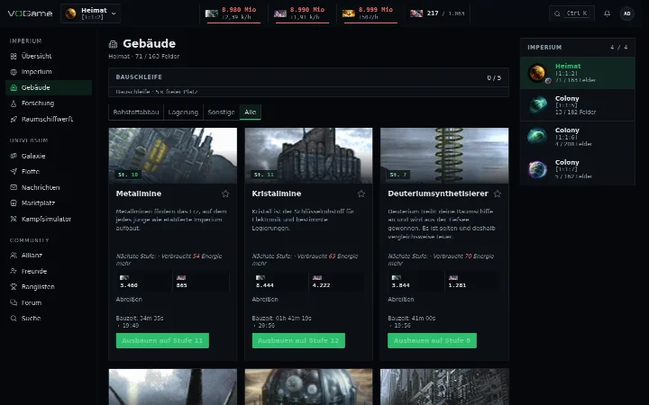
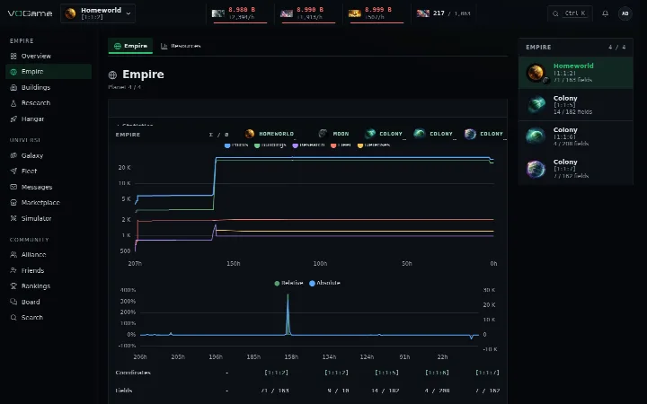

<div align="center">

# V0Game

**An open source browser space strategy game.** Build planets, research technologies, send fleets and fight it out
in alliances.

[](https://github.com/Voidys/V0Game/actions/workflows/ci.yml)
[](https://github.com/Voidys/V0Game/actions/workflows/release.yml)
[](https://github.com/Voidys/V0Game/releases/latest)
[](https://github.com/Voidys/V0Game/releases)
[](LICENSE)
<br>
[](https://www.php.net/)
[](https://symfony.com/)
[](https://twig.symfony.com/)
[](#requirements)
[](https://github.com/Voidys/V0Game/commits/main)

[**Install guide**](#quick-start) · [**Download**](https://github.com/Voidys/V0Game/releases/latest) ·
[Changelog](CHANGES.md) · [Report a bug](https://github.com/Voidys/V0Game/issues)

</div>

> **V0Game lives on at GitHub.** It is a fork of [pr0game](https://codeberg.org/pr0game/pr0game), which grew out of
> 2Moons and SteemNova. Codeberg does not allow AI-assisted coding, so the project moved here. Issues, pull requests
> and releases go to this repository.

## What is this?

V0Game is a space strategy game in the style of the classic browser games: players build up planets, research
technologies, send fleets, trade and fight together in alliances. Everything happens in the browser, on a phone too.

You run it yourself: put it on your own web space or server, and you have your own game for friends or a community.
You decide the speed, the rules and who may join. It is free and open source.

V0Game is developed by **Abraxis**.

## Contents

**Everyone**
- [Highlights](#highlights)
- [Screenshots](#screenshots)
- [Features](#features)
- [Can my hosting run it?](#can-my-hosting-run-it)
- [Quick start](#quick-start)
- [After installing](#after-installing)
- [Something does not work?](#something-does-not-work)

**Server admins and developers** (technical)
- [Requirements](#requirements)
- [Running a server](#running-a-server)
  - [Cron job](#cron-job), [Updating](#updating), [Backups](#backups), [nginx](#nginx), [Production tuning](#production-tuning), [Security checklist](#security-checklist)
- [Performance](#performance)
- [Development](#development)
- [Battle engines](#battle-engines)
- [Tech stack](#tech-stack)

**About**
- [Thanks](#thanks)
- [Origin, license and credits](#origin-license-and-credits)

## Highlights

The game rules are the same as before; everything around them is new.

| | |
| --- | --- |
| **Over 80 old game bugs fixed** | Including **3 critical** ones: a jump gate security hole, a way to duplicate ships at the repair dock, and a cleanup job that could delete every player (see the [changelog](CHANGES.md)). Four more review rounds fixed many smaller glitches since ([changelog](CHANGES.md)) |
| **Faster than pr0game** | Measured head to head on the same server with the same late-game data: galaxy and statistics pages 4–5× faster, messages up to 45 % faster, game pages on average 28 % faster with 43 % fewer database queries. The start page and the player card are still slower ([numbers](#performance)) |
| **Background jobs up to 77 % faster** | The statistics rebuild takes a quarter of pr0game's time, the daily job, fleet events and resource updates 23–34 % less, so even large servers stay quick |
| **Lighter downloads** | A first visit loads 41–71 % less than pr0game (both with compression), mainly because the scripts are 3.1 MB → 512 KB without jQuery and images are WebP |
| **Easy to set up** | A setup wizard in the browser, a ready-to-upload ZIP, and help in the admin panel when something is missing |

## Screenshots

| | |
| :---: | :---: |
| <a href="public/styles/resource/images/login/screens/01-overview.webp"></a> | <a href="public/styles/resource/images/login/screens/02-buildings.webp"></a> |
| Planet overview | Buildings |
| <a href="public/styles/resource/images/login/screens/07-empire.webp"></a> | <a href="public/styles/resource/images/login/screens/11-admin-overview.webp"></a> |
| Empire with statistics charts | Admin panel |
| <a href="public/styles/resource/images/login/screens/08-galaxy.webp"></a> | <a href="public/styles/resource/images/login/screens/06-techtree.webp"></a> |
| Galaxy | Technology tree |

### On phones

| | | | | |
| :---: | :---: | :---: | :---: | :---: |
| <a href="public/styles/resource/images/login/screens/20-mobile-overview.webp"></a> | <a href="public/styles/resource/images/login/screens/21-mobile-buildings.webp"></a> | <a href="public/styles/resource/images/login/screens/22-mobile-galaxy.webp"></a> | <a href="public/styles/resource/images/login/screens/23-mobile-fleet.webp"></a> | <a href="public/styles/resource/images/login/screens/24-mobile-drawer.webp"></a> |
| Overview | Buildings | Galaxy | Fleet | Menu sheet |

All of them, desktop and phone, are in [`public/styles/resource/images/login/screens/`](public/styles/resource/images/login/screens/); a running game shows them on its start page under Screenshots.

## Features

- **Modern interface:**
  - top bar with resources, side menu and a planet list, one strict layout for every page;
  - built for phones too: bottom tab bar in thumb reach, menus as bottom sheets, 44 px touch targets;
  - quick jump with Ctrl+K (pages, planets, coordinates), keyboard shortcuts, tooltips everywhere;
  - eight themes (new: VoidVerse) that only set colours, fonts and images (a new theme is a short file),
    popups as modals, clean web addresses (`/game/fleet` instead of `game.php?page=fleet`).
- **Player tools:**
  - push and Discord notifications for attacks, spies, returning fleets, finished queues and farms that wake up;
  - a live event list, fleet templates, a fleet save finder and an "arrive at" speed picker;
  - a raid planner in every spy report and a farm list, galaxy filters and marks, an empire hub that collects resources;
  - "build up to X" in the shipyard, combat reports with losses and profit, a read-only API for your own tools;
  - every universe setting on one page (`/rules/universe`).
- **Alliances and chat:** shared target lists, an ACS board, an activity overview, alliance wiki pages, pacts that expire,
  and an optional in-game chat (global and alliance channels, filters, reports, admin review), switched on in the admin panel.
- **Community:**
  - a built-in board with posts, votes and threaded comments;
  - news with drafts, scheduling and images;
  - a team page managed in the admin panel;
  - optional voting for your game on toplists, with rewards (off by default).
- **Admin panel:**
  - a dashboard that warns you when something needs attention (for example a missing cron job);
  - a mini CMS for rules, imprint and privacy texts, and a GDPR privacy policy filled from the game settings;
  - a server information page with health checks, database facts and game statistics.
- **Bots** (optional, off by default):
  - bot players fill a young universe; five ready-made personalities: office worker, jobless, shift worker, lunatic and noob;
  - they play on their own, no extra service needed; no two build the same;
  - optionally an AI service (OpenAI, Claude, OpenCode Go, DeepSeek, OpenRouter) gives them names, chat and alliance life;
  - start them in the setup wizard or later under **Admin → Bots**.
- **Languages:** 20 languages, all complete: German, English, Spanish, French, Italian, Dutch, Polish, Czech, Hungarian,
  Romanian, Portuguese, Brazilian Portuguese, Russian, Ukrainian, Turkish, Thai, Filipino, Vietnamese, Simplified Chinese and
  Traditional Chinese, plus two fun variants (Ogerfränkisch and pirate German).
- **Privacy and security:**
  - no Google services: no Analytics, and a self-hosted bot check instead of reCAPTCHA;
  - a modern, secure login, and every page is protected against code injected by other players;
  - optional social login: players sign in or register with Discord, Google, GitHub or Facebook (each off by default,
    switched on under **Admin → Social login**); an existing account is only linked after its password was entered once;
  - the installer creates all secrets for you.

The full list, step by step, is in the **[changelog](CHANGES.md)**.

## Can my hosting run it?

Most web hosts that offer current PHP can. Check these four points in your hosting panel or ask your host:

| You need | Why | Where to look |
| --- | --- | --- |
| **PHP 8.4** | The game is written in PHP | "PHP version" or "PHP settings" |
| **A MySQL or MariaDB database** (MySQL 8.4 / MariaDB 10.11) | Stores players, planets and fleets | "Databases" |
| **Cron jobs every minute** | Fleets, building queues and statistics are processed in the background | "Cron jobs", "Scheduled tasks" |
| **About 1 GB of space** | Mostly theme images | Your hosting plan |

Also good to have: HTTPS (a free "Let's Encrypt" certificate, offered by almost every host) and the option to choose
the folder your domain points to ("document root").

> **Watch out:** some cheap plans allow cron jobs only every 15 minutes or not at all. The game needs one every minute,
> otherwise fleets arrive late and the game feels stuck. Check this before you buy.

## Quick start

Pick the way that fits you. Each one is explained step by step below, written for non-technical readers too.

| Way | For whom | You need |
| --- | --- | --- |
| [**ZIP download**](#1-zip-download) | Ordinary web hosting, no command line | Your hosting panel and an FTP program or file manager |
| [**Install script**](#2-install-script) | A VPS or server you log into with SSH | Git, PHP 8.4, Composer (the script checks and helps) |
| [**DDEV**](#3-ddev-try-it-on-your-pc) | Trying it on your own PC | Docker and DDEV |

### 1. ZIP download

1. **Download** `v0game-<version>.zip` from the [latest release](https://github.com/Voidys/V0Game/releases/latest).
   Download only from that page. *Optional but recommended:* also download the `.sha256` file and
   [check that the ZIP is undamaged](#check-the-download).
2. **Upload** the ZIP to your web space and unpack it there (most file managers in hosting panels can do this; it is
   much faster than uploading the unpacked files). The ZIP is about 80 MB, mostly theme artwork.
3. **Point your domain to the `public/` folder.** In the hosting panel look for "Domains" and "Document root" (also
   called "Web root") and set it to the `public` folder inside the unpacked folder, for example `v0game/public`.
   This keeps passwords and program files out of reach of visitors. [Why and how](#the-domain-and-the-public-folder).
4. **Create an empty database** in the hosting panel and write down its host (often `localhost`), name, user and password.
5. **Open `https://your-domain/install/`** and follow the wizard. It checks your hosting, asks for the database
   details, the game name, speed and your admin account. Do this right after uploading: until it is finished,
   anyone who opens the page could set the game up.
6. **Set up the cron job.** The last wizard page shows a line like
   `cd /path/to/v0game && php bin/console app:cron:run --quiet`. Create a cron job in your hosting panel that runs it
   **every minute**. Without it fleets never arrive and nothing progresses.
   [Step-by-step help for hosting panels](#cron-job).
7. **Turn on HTTPS** in the hosting panel, if it is not on yet (activate the certificate and, if offered, "force
   HTTPS"). Then open `https://your-domain/` and log in with your administrator account.

<a id="check-the-download"></a>**Checking the ZIP:** the `.sha256` file proves the ZIP was not damaged or changed on the
way. Compare it with your own calculation:
- Windows (Command Prompt): `certutil -hashfile v0game-<version>.zip SHA256`
- macOS: `shasum -a 256 v0game-<version>.zip`
- Linux: `sha256sum -c v0game-<version>.zip.sha256` (both files in the same folder; it prints `OK`)

On Windows and macOS compare the printed value with the one in the `.sha256` file by eye. If they differ, download
again and do not use the file.

**Uploading:** if the file manager can extract ZIPs, upload the ZIP itself and extract it on the server; that is much
faster than uploading thousands of files. Otherwise unpack it on your computer and upload **the content of the folder**
`v0game-<version>`, including the hidden file `.env`. Ideally put the project *next to* the public folder, not inside it,
for example `/home/you/v0game/`.

**What the setup wizard does:** it has five steps: server check and licence, database, game name and administrator
account, optional features (in-game chat, bots, e-mail, legal texts), and a summary with the next steps. If the check
lists something in red, fix it first, most often missing write permissions on `var/`, `config/` and `.env.local`
(folders 775, files 664 in the file manager, or ask the host). The wizard only works while the game is not installed:
as soon as the administrator account exists it closes itself. If the admin overview warns that the file
`var/ENABLE_INSTALL_TOOL` exists, delete it.

<a id="the-domain-and-the-public-folder"></a>**The domain and the `public/` folder:** the web address of your site must
lead to `public/`, not to the project folder. Everything else (the database password in `config/game.php`, the source
code, backups in `var/`) must never be reachable from the internet. If the host cannot change the document root, do not
upload the project into the public web folder: put it one level above and ask the support to point the domain to
`public/`, or choose different hosting. A project folder that is web-accessible exposes your secrets.

**Creating the database:** open "Databases" (MySQL/MariaDB) in the panel, create a database and a user with a strong
password, and give the user all rights on it.

### 2. Install script

Download it, read it, then run it. Please don't pipe it into a shell.

```sh
curl -fsSLO https://raw.githubusercontent.com/Voidys/V0Game/main/install.sh
less install.sh
bash install.sh                 # interactive menu
bash install.sh --help          # all options, e.g. --mode server --dir /var/www/v0game --dry-run
```

The script:
- checks PHP, its extensions and Composer, with install hints for apt, dnf and pacman;
- fetches the latest release and installs the dependencies;
- runs the command line installer or points you to the web wizard;
- prints the remaining steps at the end.

It never runs `sudo` by itself. You can also run the installer directly:

```sh
php bin/console app:install     # asks for everything, or pass --no-interaction with options (see --help)
```

Then:
- set your web server's **document root to the `public/` folder** of the install directory, not the project folder
  itself ([nginx example](#nginx); Apache: `DocumentRoot …/public` with `AllowOverride All`, PHP via PHP-FPM or
  `mod_php` 8.4, the `.htaccess` in `public/` does the rewriting);
- let the web server's user write to `var/`, `public/uploads/`, `public/stats/`, `config/` (until installed) and
  `.env.local`, for example `sudo chgrp -R www-data var public/uploads public/stats config .env.local`;
- add the **cron job** that runs every minute:
  `* * * * * cd /path/to/v0game && php bin/console app:cron:run --quiet` (`crontab -e` as the web server's user;
  [details](#cron-job));
- turn on HTTPS, for example with certbot (`certbot --nginx`).

The script and `php bin/console app:install` also run unattended, with secrets taken from the environment:

```sh
bash install.sh --version v1.26.4 ...                          # a specific release (default: latest)
bash install.sh --dry-run --mode server --dir /tmp/x --yes    # show what would happen
V0GAME_DB_PASSWORD=... V0GAME_ADMIN_PASSWORD=... bash install.sh --mode server --dir /var/www/v0game --yes \
    --db-name v0game --db-user v0game --admin-name admin --admin-email you@example.com --language en --speed classic
```

The `--db-*`, `--game-name`, `--language`, `--timezone`, `--speed` (`classic`, `fast`, `blitz`), `--registration`
(`open`, `closed`), `--admin-*`, `--bots`, `--chat`, `--chat-global`/`--no-chat-global`,
`--chat-block-links`/`--no-chat-block-links` (the chat is off unless `--chat`) and `--base-url` options go to
`bin/console app:install`. The script writes `.env.local` (production mode, random `APP_SECRET`; the admin dashboard
warns if the secret is a public default or too short, or if the server runs in development mode).

### 3. DDEV (try it on your PC)

```sh
git clone https://github.com/Voidys/V0Game.git
cd V0Game
ddev start
ddev composer install
```

Then open **https://v0game.ddev.site/install/**. DDEV runs the cron job by itself.

## After installing

1. **Log in** at `https://your-domain/` with the admin account from the wizard. The admin panel is at
   `https://your-domain/admin`.
2. **Look at the admin home page.** It says "All good" or lists what still needs attention, for example a cron job
   that is not running yet, or the web address that e-mails need for their links.
3. **Check the settings** under **Admin → Settings**: game name, universe speed, registration, and e-mail (needed for
   password resets and account activation).
4. **Optional:** add bots under **Admin → Bots** so the universe does not feel empty, write the rules and imprint
   under **Admin → Content**, post a first news entry, and let players sign in with Discord, Google, GitHub or Facebook
   under **Admin → Social login** ([setup](#social-login)).
5. **Invite your players.** They register on the start page.

Keep backups of the database and of `config/game.php` ([how](#backups)).

## Something does not work?

| What you see | Most likely cause |
| --- | --- |
| **"403 Forbidden"** on `/install/` or every page | The domain points to the project folder instead of `public/` ([step 3](#1-zip-download)) |
| **Fleets never arrive**, buildings don't finish, statistics don't update | The cron job is not running. The admin home page warns about this ([help](#cron-job)) |
| **White page or "Error 500"** right after uploading | Often a **missing PHP extension** (compare with [Requirements](#requirements), `php -m`) or PHP older than 8.4 for the web (not just the command line). Look at `var/log/game.log` and the web server's error log |
| **Pages show without design**, or every page except the start page gives 404 | The web server ignores the `.htaccess` file (Apache: `AllowOverride All`; nginx: see the [nginx example](#nginx), Apache also needs `mod_rewrite`) |
| **"Not writable"** in the wizard, or errors about `var/` | The web server needs write access to `var/`, `config/` and `public/uploads/` (folders 775, files 664 in the file manager) |
| **The wizard says it is closed** | The game is already installed (`config/game.php` exists), or `var/` is not writable so the unlock file cannot be created |
| **Blank or odd pages after an update** | Run `php bin/console cache:clear` and empty `var/game/` |
| **Nothing happens in the background** | Run the cron command by hand (`php bin/console app:cron:run`) and read the output. Check the panel's cron logs and that the PHP binary is 8.4. **Admin → Information** shows the health checks |

Still stuck? [Open an issue](https://github.com/Voidys/V0Game/issues) with the last lines of `var/log/game.log` (remove
passwords first).

## Requirements

*From here on it gets technical. If you just want to run a game, the sections above are all you need.*

The technical list for server admins:

| | |
| --- | --- |
| PHP | 8.4 with `curl`, `ctype`, `gd`, `intl`, `json`, `mbstring`, `mysql` (pdo_mysql), `xml`, `zip`, `opcache` (recommended), `openssl` (for SMTP with TLS) |
| Database | MySQL 8.4 or MariaDB 10.11 |
| Web server | nginx or Apache with the document root on `public/` ([nginx example with WebP delivery](#nginx)) |
| Cron | One job every minute (see [Cron job](#cron-job)) |
| Composer | Only for the script and git installs; the release ZIP already contains `vendor/` |
| Battles | The fast Rust engine needs Linux x86_64 with glibc ≥ 2.30 and PHP's `proc_open`. Everywhere else the PHP engine is used automatically, with the same results |

## Running a server

- **Cron:** the game's background jobs (fleets, statistics, cleanup, bots…) run every minute, see [Cron job](#cron-job).
- **Health check:** **Admin → Information** shows ok/warning/error checks for:
  - PHP, its extensions and OPcache;
  - writable folders, pending migrations and cron;
  - the battle engine, HTTPS and mail.
- **Updates and backups:** see [Updating](#updating) and [Backups](#backups).
- **Performance:** OPcache, preloading and an authoritative class map, see [Production tuning](#production-tuning).
- **Compression and caching:** see the [nginx](#nginx) section (also for Apache).
- **Security:** see the [security checklist](#security-checklist).
- <a id="social-login"></a>**Social login** (Discord, Google, GitHub, Facebook; all off by default):
  1. set `DEFAULT_URI=https://your-domain` in `.env.local` (the callback addresses are built from it; without it,
     outside development, no provider works);
  2. create an OAuth app at the provider and enter its callback address `https://your-domain/login/<provider>/callback`
     (shown in **Admin → Social login**; the callback is always at the site root);
  3. paste client ID and secret into **Admin → Social login** and switch the provider on. The secret is never shown
     again; an empty field keeps the stored value.

  | Provider | Where to create the app | Scopes |
  | --- | --- | --- |
  | Discord | [discord.com/developers/applications](https://discord.com/developers/applications) (OAuth2, add the redirect) | `identify email` |
  | Facebook | [developers.facebook.com/apps](https://developers.facebook.com/apps/) (use case Facebook Login, valid OAuth redirect URI) | `email public_profile` |
  | GitHub | [github.com/settings/developers](https://github.com/settings/developers) (OAuth App, authorization callback URL) | `read:user user:email` |
  | Google | [console.cloud.google.com/apis/credentials](https://console.cloud.google.com/apis/credentials) (OAuth client ID, type Web application) | `openid email profile` |

  A login whose e-mail matches an existing account is never linked automatically: the owner confirms with the account
  password once. The e-mail counts as verified for Discord, Google and GitHub (primary verified address), never for
  Facebook, so Facebook cannot register or match by e-mail; it can log in once linked from the account settings.
  Players can connect or disconnect providers in their account settings; disconnecting the last login method of an
  account without a password is refused. Players who register through a provider get an unusable password (they can set
  one later with "lost password").

### Cron job

In the panel look for "Cron jobs" (also "Scheduled tasks", "Cronjobs"). Add a job that runs **every minute**
(`* * * * *`, or "every minute" in the drop-down) with this command (adjust the path to your project, and use the
PHP 8.4 binary if the panel has several):

```
cd /home/you/v0game && php bin/console app:cron:run --quiet
```

Some panels want only the program and arguments, then use `/usr/bin/php8.4 /home/you/v0game/bin/console app:cron:run --quiet`.
On a server, add it with `crontab -e` as the web server's user (or your own):
`* * * * * cd /var/www/v0game && php bin/console app:cron:run --quiet`.

After a few minutes **Admin → Information** should show the cron as running. As long as the cron has never run or its
last run is more than 5 minutes old, the admin home page shows a warning.

The minute cron also runs the cronjob `fleets`, which processes due fleet events (arrivals, returns), so fleets advance
at least once a minute without anyone loading a page. For on-time arrivals (important for PvP) a server you control
should additionally run the fleet driver every few seconds, as a systemd service or supervisor program (it is safe next
to the cron and page requests, event claims are atomic):

```
cd /var/www/v0game && while true; do php bin/console app:fleets:run --quiet; sleep 5; done
```

systemd: `ExecStart=/bin/sh -c 'while true; do php bin/console app:fleets:run --quiet; sleep 5; done'` with
`WorkingDirectory=/var/www/v0game`, `Restart=always`. Shared hosting without long-running processes keeps the minute
cron only. DDEV starts the loop by itself.

### Updating

**Always back up first** (see [Backups](#backups)).

- **ZIP installation:** download and [verify](#check-the-download) the new ZIP. Replace all files of the project
  **except `config/` (your `game.php`), `.env.local`, `var/`, `public/uploads/` and `public/stats/`**: delete the old
  folders `src`, `templates`, `translations`, `vendor`, `public`, `install`, `bin` first, then upload the new ones (do not
  merge old and new `vendor/`). Then open the site once: pending database migrations run automatically on that request.
  Read [`CHANGES.md`](CHANGES.md) for notes on the version.
- **Script or git installation:** `cd` into the project and run `bash install.sh --dir .` (it detects the checkout and
  updates), or by hand: `git pull` (or `git fetch --tags && git checkout v<new>`) and
  `composer install --no-dev --optimize-autoloader --classmap-authoritative`. Migrations run on the next request.
- If something looks odd afterwards, clear the cache: `php bin/console cache:clear` (or empty `var/cache/` and
  `var/game/`). Do the same after editing the config tables by hand, so the cached configuration is read again.
- **Community links:** the game no longer ships links to the pr0game Discord, wiki, donation page or userscripts. A fresh
  install shows none. If your server relied on them, set them in the admin area under *Configuration > Community links*
  (`discord_url`, `wiki_url` without trailing slash, `donate_url`, `userscripts_url`); an empty field hides the link
  everywhere. Old values are not migrated.

### Backups

- **Database** (the game itself): `mysqldump --single-transaction -u USER -p DBNAME > v0game-$(date +%F).sql`, or
  "Export" in phpMyAdmin or the hosting panel. The admin panel can also create dumps into `var/backups/`.
- **Files:** `config/game.php` and `.env.local` (credentials; keep them private) and `public/uploads/`. Everything else
  can be re-downloaded.
- Store backups outside the web space and test a restore now and then.

### nginx

The document root is `public/`. Only that directory is served; everything else in the repository (config, source,
cache) is not reachable from the web. All requests that don't match a file in `public/` go to the front controller
`public/index.php` (Symfony). That includes the game's own URLs like `/game/overview` or `/admin/bans`, which are routes,
not files.

Example server block (the `map` and compression lines belong in the `http` context, e.g. a file in `conf.d/`):

```nginx
# serve foo.png.webp instead of foo.png to browsers that accept WebP (copies made by bin/console app:images:webp;
# the theme images already ship as WebP, so this only matters for the remaining JPG/PNG/GIF files)
map $http_accept $webp_suffix {
    default        "";
    "~*image/webp" ".webp";
}

# CSS/JS URLs carry ?v=<git hash or mtime>: cache them for good; unversioned ones revalidate
map $arg_v $asset_cache_control {
    default "public, max-age=31536000, immutable";
    ""      "no-cache";
}

# versioned images and the icon sprite (?v=<mtime>): immutable too; unversioned images keep the one-year cache with revalidation
map $arg_v $image_cache_control {
    default "public, max-age=31536000, immutable";
    ""      "public, max-age=31536000, stale-while-revalidate=604800";
}

gzip on;
gzip_comp_level 5;
gzip_vary on;
gzip_static on;
gzip_types text/css application/javascript text/javascript application/json image/svg+xml;

brotli on;                  # ngx_brotli (optional module); delete the brotli lines without it
brotli_comp_level 5;        # dynamic HTML: 4-5 is fast enough; static files are precompressed at level 11
brotli_static on;           # serve foo.css.br when it exists and the client accepts br
brotli_types text/css application/javascript text/javascript application/json image/svg+xml;

server {
    server_name v0game.example;
    root /var/www/v0game/public;

    # Universe prefixes for static files: /uni2/styles/... -> /styles/...
    location ~ ^/uni[0-9]+/(styles|scripts)/ {
        rewrite ^/uni[0-9]+/(.*)$ /$1 last;
    }

    # versioned CSS/JS: immutable (same as public/.htaccess)
    location ~* \.(css|js|mjs)$ {
        add_header Cache-Control $asset_cache_control;
        try_files $uri =404;
    }

    # WebP copies of static images (same as the Apache rule in public/.htaccess)
    location ~* \.(png|jpe?g|gif)$ {
        add_header Vary Accept;
        add_header Cache-Control $image_cache_control;
        try_files $uri$webp_suffix $uri =404;
    }

    location ~* \.(svg|woff2?|ico)$ {
        add_header Cache-Control $image_cache_control;
        try_files $uri =404;
    }

    # Theme metadata files are read by PHP, not served
    location ~ \.cfg$ {
        deny all;
    }

    location / {
        try_files $uri /index.php$is_args$args;
    }

    location ~ ^/index\.php(/|$) {
        fastcgi_pass unix:/run/php/php8.4-fpm.sock;
        fastcgi_split_path_info ^(.+\.php)(/.*)$;
        include fastcgi_params;
        fastcgi_param SCRIPT_FILENAME $realpath_root$fastcgi_script_name;
        fastcgi_param DOCUMENT_ROOT $realpath_root;
    }

    # a request for any .php file goes to the front controller (the game's URLs are Symfony routes, not files)
    location ~ \.php$ {
        rewrite ^ /index.php last;
    }
}
```

**Compression and caching**
- **Brotli** (`ngx_brotli`, e.g. `apt install libnginx-mod-http-brotli-filter libnginx-mod-http-brotli-static`) is about
  15 % smaller than gzip: the CSS of a game page 79 KB gzip, 68 KB brotli; HTML 9-17 KB against 8-14 KB.
- **Precompressed files:** `gzip_static on;` and `brotli_static on;` serve `foo.css.br` / `foo.css.gz` when it exists and
  the client accepts it, so CSS, JS and the icon sprite are compressed once at the highest level instead of on every
  request. `tools/build/precompress.sh` writes them next to the sources (css, js, svg, json below `public/styles` and
  `public/scripts`; it skips `.br` when `brotli` is not installed). Run it after every deploy; stale files are rebuilt
  because the source is newer. The files are generated and not committed.
- **Apache:** `public/.htaccess` uses `mod_brotli` when loaded, else `mod_deflate`. `mod_deflate` changes the ETag to
  `"...-gzip"`, and Apache then answers a conditional request carrying that ETag with a full `200` instead of `304`.
  Best fix, in the vhost/server config (not allowed in `.htaccess`): `DeflateAlterETag NoChange` (Apache 2.4.58+ also for
  mod_brotli: `BrotliAlterETag NoChange`). Without access to it, `public/.htaccess` drops the ETag of CSS, JS, SVG and
  JSON (`Header unset ETag`), so the browser revalidates with `If-Modified-Since` and gets `304`. `?v=` assets are
  immutable and never revalidated either way.
- **Caching:** `?v=` URLs (CSS, JS, the icon sprite, image variants) get `public, max-age=31536000, immutable`;
  unversioned images keep the one-year cache with `stale-while-revalidate`; HTML stays `max-age=0, must-revalidate` (not
  `no-store`, so the back/forward cache keeps working).
- **Public pages (HTTP cache):** anonymous GETs of the public pages (news, rules, universe rules, hall of fame, battle
  hall, team, legal pages) are sent with `Cache-Control: public, max-age=300, s-maxage=300`, public combat reports with
  one day and an ETag; none of them sets a cookie. Logged-in visitors, `?lang=` and the login/register/lost-password
  forms stay private. A reverse proxy cache (`proxy_cache`/`fastcgi_cache`) may store them, but must honour
  `Vary: Accept-Language, Cookie` (e.g. bypass the cache when a `2Moons` or `REMEMBERME` cookie is present).

### Production tuning

Out of the box (and in DDEV) PHP checks every file on every request. On a production server set, for PHP-FPM:

```ini
opcache.enable=1
opcache.validate_timestamps=0        ; reload PHP-FPM (or opcache_reset()) on every deploy
opcache.memory_consumption=256
opcache.max_accelerated_files=20000
opcache.preload=/path/to/v0game/config/preload.php
opcache.preload_user=www-data
```

and install with `composer install --no-dev --optimize-autoloader --classmap-authoritative` (or
`composer dump-autoload --no-dev --classmap-authoritative` on an existing install). This saves about 20 % per request
(overview 34.5 → 27.0 ms, start page 21.8 → 16.1 ms on the test machine). Deploy steps: `git pull`, `composer install …`,
`bin/console cache:clear`, clear `var/game/` (admin "clear cache"), run `bin/console cache:warmup`, reload PHP-FPM. With
`validate_timestamps=0` PHP never notices edited files by itself; the game's own cache files are safe because they are
compared by key, not by file time. `config/preload.php` loads the preload file Symfony writes on cache warmup
(`var/cache/prod/*.preload.php`), hence the warmup before the reload.

The cron job boots the application once a minute. `opcache.file_cache` keeps the compiled scripts between these
short-lived runs (about 190 → 115 ms per run with nothing due):

```sh
* * * * * cd /path/to/v0game && php -d opcache.enable_cli=1 -d opcache.file_cache=/var/cache/v0game-opcache -d opcache.file_cache_only=0 bin/console app:cron:run
```

The directory must exist and be writable for the cron user. The FPM settings above do not apply to the command line,
which has its own `php.ini` section.

### Security checklist

- [ ] HTTPS on, HTTP redirects to HTTPS
- [ ] Document root is `public/` (check: `https://your-domain/config/game.php` and `/.env` must give 404, not content)
- [ ] `config/game.php` and `.env.local` are not world-readable (640/660) and never uploaded anywhere public
- [ ] Strong, unique administrator password
- [ ] Mail configured (Admin → settings), so password resets work
- [ ] `var/ENABLE_INSTALL_TOOL` does not exist after installing
- [ ] Production mode: `APP_ENV=prod` (the checked-in `.env` defaults to `prod`, the installer also writes `APP_ENV=prod` and `APP_DEBUG=0` to `.env.local`; only DDEV switches to `dev`). Never set `APP_ENV=dev` on a public server: in `dev` the Symfony profiler and debug pages are reachable
- [ ] PHP, MySQL/MariaDB and the operating system receive updates; update V0Game when new versions appear
- [ ] Regular backups
- [ ] Behind a reverse proxy or load balancer: `SYMFONY_TRUSTED_PROXIES` set (see below)
- [ ] `DEFAULT_URI` in `.env.local` is your public address (the setup wizard writes it); e-mail links (password reset, account activation) use it. Without it (outside development) those mails are not sent (an error is logged per refused mail and the admin home page shows a warning): the Host header of a request is never used for links. The web installer writes it from the address you opened it at, `app:install` from `--base-url`; an existing install must add `DEFAULT_URI=https://your-domain` to `.env.local`
- [ ] `TRUSTED_HOSTS` in `.env.local` lists the host names of your site (see below)
- [ ] Anti-abuse settings reviewed per universe (Admin → universe settings, see below). Their defaults keep the classic, permissive rules; the admin home page lists every protection that is still off

**Reverse proxies and client IPs.** The game stores each player's IP address (multi-account detection, login history,
abuse limits). It trusts only the address of the TCP connection by default; `X-Forwarded-For` and similar headers are
ignored, so nobody can fake an address with a request header. If a reverse proxy, CDN or load balancer sits in front of
the web server, every request comes from the proxy and all players would share one IP. Tell the game which proxies to
trust, in `.env.local`:

```
# comma separated IP addresses or CIDR ranges of your proxies
SYMFONY_TRUSTED_PROXIES=127.0.0.1,10.0.0.0/8
# or: trust whatever connects directly (only if the web server is not reachable except through the proxy)
SYMFONY_TRUSTED_PROXIES=REMOTE_ADDR
```

The proxy has to set `X-Forwarded-For` (and `X-Forwarded-Proto` for HTTPS). Behind Cloudflare use its published IP
ranges. DDEV: the router container is the proxy, so a local `SYMFONY_TRUSTED_PROXIES=REMOTE_ADDR` shows the browser's
address.

**Trusted hosts.** The `Host` header comes from the visitor. To make sure the game only ever works with your own names,
set in `.env.local`:

```
# comma separated host names; "*.example.com" admits sub-domains (uni2.example.com) and example.com itself
TRUSTED_HOSTS=example.com,www.example.com
```

Requests with any other `Host` header are answered with 400. Leave it empty during development (DDEV). Mail links do
not depend on it: they are built from `DEFAULT_URI`.

**Anti-abuse settings.** These universe settings decide how hard pushing and collusion are. The defaults are the safe
values (existing universes still on the former permissive defaults were switched by migration 1794902100). Operators may
relax them; the admin overview warns while a setting is relaxed:

| Setting | Default | Recommended | Effect |
| --- | --- | --- | --- |
| `transport_push_check` + `transport_push_limit` | on, `100000` | on, e.g. `100000` | refuses transports, holds and transfers to another player when the 7-day value sent minus the value returned (deuterium units, transferred ships at cost) exceeds the limit; both must be set |
| `market_push_tolerance` | `10` % | `10` | allowed value skew of a market trade |
| `honor_pair_cap` | `3` | `3` (`0` = unlimited) | honourable fights per pair of players per day |
| `bash_war_exempt` | off | off | a declared war lifts the bash limit (never between accounts sharing an IP or a multi group) |
| `depot_cost_real_consumption` | on | on | alliance depot holds cost the fleet's real consumption |

Always on, no setting: no rebuild protection after losing a fleet only to linked accounts (shared IP, multi group,
alliance, buddy). By rule, interplanetary missile flights never occupy a fleet slot (they are still counted for bash
protection, `bash_count_missiles`). The admin page "abuse report" lists one-sided transfers, repeated trades, rebuild
protection grants and late recalls for review.

**What the game does for you**
- Every state-changing request (all forms, fetch calls and action links) carries a per-session CSRF token; requests
  without it get `403`. Behind a cache, never cache logged-in or form pages.
- Session cookie: `HttpOnly`, `SameSite=Lax`, `Secure` on HTTPS; the session id is renewed on login, logout and when the
  admin password is entered. A password change ends all other sessions of the account.
- Failed logins are throttled (5 per 15 minutes per IP and e-mail); registration, "lost password" and the admin password
  prompt have their own limits (`config/packages/framework.yaml`, `rate_limiter`). The counters live in the application
  cache (`var/cache`); clear them with `bin/console cache:pool:clear cache.rate_limiter`.
- In-game request limit per account: token buckets for state-changing requests (POSTs and the action links) and for
  expensive pages (galaxy, player card, search, statistics, battle hall, battle reports, records). Beyond the budget the
  player gets a translated `429` page (JSON `429` for script calls) with a `Retry-After` header. The defaults are
  generous (actions: burst 30, 1 per second; reads: burst 60, 2 per second), so normal play never sees it. Tune or switch
  off with the `app.game_rate_limit.*` parameters in `config/services.yaml` (`enabled: false` turns it off); the board's
  daily caps are `app.board_votes_per_day` and `app.board_writes_per_day`.
- Optional daily fleet caps per account (fixed window of 24 h from the first counted launch), off by default (`0`):
  `app.fleet_launches_per_day` limits all fleet launches (including the galaxy spy and recycle shortcuts and missiles,
  but not market purchase fleets), `app.attacks_per_day` limits attacks (attack, ACS attack and join, destruction,
  missile). Set them in `config/services.yaml`; a refused launch is not counted.
- Responses carry `X-Content-Type-Options`, `Referrer-Policy`, `X-Frame-Options` and `Permissions-Policy` headers.

## Performance

### Compared with pr0game

V0Game and pr0game ([commit 2b65627](https://codeberg.org/pr0game/pr0game/commit/2b65627953f692104554c3a21e8a0f61f645c170))
side by side on the same machine (PHP 8.4, MySQL 8.4, production mode, the same OPcache settings), each with the same
generated universe: 1000 players, 5000 planets, 1500 moons, 40 alliances, 800 fleets in flight and 100k messages.
Times are medians of 15 alternating requests (method and caveats below the tables).

| Page | pr0game | V0Game | Change | Queries pr0game → V0Game |
| --- | ---: | ---: | ---: | ---: |
| Start page | 12.5 ms | 17.6 ms | +40 % | 5 → 4 |
| Overview | 45.3 ms | 40.8 ms | -10 % | 46 → 28 |
| Buildings | 28.8 ms | 32.3 ms | +12 % | 38 → 22 |
| Research | 30.7 ms | 30.1 ms | -2 % | 39 → 23 |
| Shipyard | 30.9 ms | 27.3 ms | -12 % | 37 → 21 |
| Defense | 30.1 ms | 24.6 ms | -18 % | 37 → 21 |
| Galaxy | 153.0 ms | 35.1 ms | -77 % | 69 → 27 |
| Fleet (ship table) | 30.8 ms | 33.0 ms | +7 % | 41 → 25 |
| Empire | 50.8 ms | 43.3 ms | -15 % | 119 → 66 |
| Messages | 54.8 ms | 42.8 ms | -22 % | 47 → 29 |
| Messages, spy reports | 128.5 ms | 70.7 ms | -45 % | 48 → 40 |
| Statistics | 191.9 ms | 36.3 ms | -81 % | 90 → 27 |
| Alliance | 32.7 ms | 29.4 ms | -10 % | 48 → 32 |
| Player card | 28.4 ms | 35.1 ms | +24 % | 34 → 31 |

| Background job | pr0game | V0Game | Change |
| --- | ---: | ---: | ---: |
| Statistics rebuild | 3372 ms, 7950 queries | 762 ms, 144 queries | -77 % |
| Daily cronjob | 1364 ms | 907 ms | -34 % |
| Fleet events (about 270 due, with battles) | 6489 ms | 4800 ms | -26 % |
| Resource update, 5000 planets with save | 18638 ms | 14308 ms | -23 % |
| Cleaner cronjob | 1600 ms | 2158 ms | +35 % |

**Downloads** (desktop Chromium, pr0game with gzip switched on so both are compressed): a first visit loads 41–71 % less,
for example the overview 620 → 219 KB. Repeat visits load only the HTML, which is up to about 70 % (2–6 KB) larger in
V0Game because it carries more on each page.

**Where V0Game is behind:**
- The start page takes about 5 ms longer: that is the fixed cost of booting Symfony and the game.
- The player card is measured as a full page here; in the game it opens as a popup of 6 KB in about 25 ms.
- Buildings (+12 %) and the fleet table (+7 %) are within the noise of the run: with the tuned settings both are on par or faster.
- The cleaner cronjob deletes old messages from two tables instead of one and takes about a third longer. It runs once a day.

**Method and caveats:**
- Both games ran in DDEV containers on one machine, installed with their own installers and filled by the same seeded
  generator; the pages were requested alternately (A/B/A/B). The requests go to the PHP built-in server inside each
  container, so the times are **application time** without a web server.
- It was one machine, and the second measuring round ran while it was noticeably slower, so only the **ratios** inside a
  round are comparable, not the absolute times. Differences of about 10 % on the small pages are within noise.
- The player card is measured as a full page in both games; in V0Game it opens as a popup of 6 KB in about 25 ms.
- V0Game does more per request (CSRF, rate limits, game-events data island) and its pages carry more HTML.
- Background jobs ran on the command line against the same restored database, median of 3. V0Game's cron runner boots
  once a minute (about 0.2 s with nothing due) and the fleet runner every 5 seconds; pr0game does both inside page
  requests. That cost is **not** part of the page times above.

### Compared with the code before the performance work

Game results are unchanged: every change was checked with crawl
diffs of all pages, and the statistics and resource routines were checked by running old and new code side by side.

**Pages.** The times are medians in production mode. "Tuned" adds the OPcache and Composer settings from
[Production tuning](#production-tuning). The two measuring rounds ran on different machines, so the time changes combine
the ratios of both rounds.

| Page | Queries before → now | Time, default | Time, tuned |
| --- | ---: | ---: | ---: |
| Start page | 8 → 5 | -26 % | -47 % |
| News | 9 → 6 | -25 % | -55 % |
| Account | 14 → 8 | -23 % | -50 % |
| Overview | 48 → 25 | -29 % | -49 % |
| Buildings | 40 → 20 | -26 % | -46 % |
| Research | 40 → 21 | -31 % | -49 % |
| Shipyard | 39 → 19 | -34 % | -52 % |
| Galaxy | 71 → 25 | -41 % | -60 % |
| Messages | 49 → 30 | -28 % | -48 % |
| Statistics | 47 → 24 | -33 % | -59 % |
| Empire | 116 → 28 | -54 % | -65 % |
| Alliance | 41 → 31 | -30 % | -46 % |
| Admin overview | 22 → 11 | -28 % | -52 % |

**Background jobs** (1000 players, 5000 planets, 100k messages):

| Job | Before | Now | Change |
| --- | ---: | ---: | ---: |
| Statistics cronjob | 1560 ms, 4375 queries | 213 ms, 66 queries | -86 % |
| Statistics build | 601 ms, 1090 queries | 150 ms, 52 queries | -75 % |
| Records build | 976 ms, 3281 queries | 35 ms, 10 queries | -96 % |
| Resource update, 5000 planets | 2581 ms, 10000 queries | 1130 ms, 5000 queries | -56 % |
| Resource update, 1000 planets with save | 951 ms | 644 ms | -32 % |
| Fleet events, 600 due fleets | 2687 ms | 2048 ms | -24 % |

**What else got faster:**
- Galaxy:
  - switching systems no longer reloads the page;
  - with 100k messages a system switch takes about 28 ms instead of 168 ms, thanks to a new index.
- Smaller pages: tooltips are sent once per page instead of once per element. The galaxy page went from 258 to 108 KB,
  buildings from 121 to 63 KB and research from 95 to 54 KB.
- Messages:
  - one query for all counters;
  - only the text of the shown page is loaded;
  - spy reports are rendered once and then cached.
- Every request:
  - the universe config and the migration check are cached;
  - fleet events, ban checks and tutorials cost no queries when there is nothing to do;
  - read-only page views take no row locks.
- Frontend:
  - no jQuery (scripts 3.1 MB → 512 KB);
  - brotli/gzip and long-term caching for versioned assets;
  - preloaded fonts and lazy-loaded building images;
  - WebP images;
  - theme artwork 139 → 83 MB.

## Development

Local development uses [DDEV](https://ddev.readthedocs.io/) (see [Quick start](#3-ddev-try-it-on-your-pc)).

```sh
ddev exec bin/console lint:twig templates                                   # template syntax
ddev exec bin/console lint:container                                        # service container
ddev exec vendor/bin/php-cs-fixer fix                                       # code style: PER Coding Style
```

- **Testing:** PHPUnit (`tests/Unit` needs no database, `tests/Integration` runs against a dedicated database `db_test`):

  ```sh
  ddev exec vendor/bin/phpunit                        # everything (also: ddev composer test)
  ddev exec vendor/bin/phpunit --testsuite Unit       # no database needed (also: ddev composer test:unit)
  ddev exec vendor/bin/phpunit --filter BuildFunctionsTest
  ```

  - The test database name must end in `_test` (`.env.test`, `DATABASE_URL`); the tests refuse to run against anything else, so the dev database `db` is never touched. DDEV's `db` user may need `GRANT ALL ON db_test.*`; DDEV's root user can do that (`ddev mysql -uroot -proot -e "CREATE DATABASE IF NOT EXISTS db_test; GRANT ALL ON db_test.* TO 'db'@'%';"`).
  - Every run rebuilds the schema of `db_test` from `install/install.sql` and the migrations; each test runs in a rolled-back transaction.
  - The mechanics tests compare against golden values captured from the code before the legacy renewal (prices, build times, production, queues, fleet maths, battles). A failing golden test means a result changed; only update the value (`GOLDEN_CAPTURE=1 vendor/bin/phpunit --filter <Class>` prints the new values to `var/golden/`) when the change is intended.
  - The Rust battle engine is checked against the PHP engine with the same seed (`mt_srand` / `BattleEngineRust::useSeed()`): results must be identical field by field, on the golden fleets and on 300 generated battles (`BATTLE_PARITY_RUNS=5000` for a longer soak). `sh tools/battlerust/build.sh test` runs the crate's own tests (RNG against PHP sequences, engine rules).
- **Static analysis:** PHPStan level 6 — new code needs full parameter, return and property types (`phpstan.dist.neon`, known findings in `phpstan-baseline.neon`; the symfony extension reads `var/cache/dev/App_KernelDevDebugContainer.xml`, so warm the dev cache first):

  ```sh
  ddev composer phpstan
  ```

  New findings fail the run; fix them rather than extending the baseline.
- Errors land in `var/log/`. After changing translations or game data, clear `var/game/`.
- Templates are Twig with autoescaping and the `game_html` strategy: code-built HTML must be a `Twig\Markup` or `|raw`, because request input is already encoded (`App\Twig\GameEscaping`).
- Layout and themes: the shared layout lives in `public/styles/resource/css/app/` (`ui.css`); a theme only sets the `--theme-*` tokens of `theme-contract.css` (copy an existing theme in `public/styles/theme/` to make a new one).
- **CI** ([`ci.yml`](.github/workflows/ci.yml)) runs on every push to `main` and on every pull request:
  - composer validate;
  - PHP syntax, Twig, YAML and container lint;
  - a docblock on every complex function and no method over 80 lines (`tools/ci/docblock-check.php`,
    `tools/ci/long-methods-check.php`);
  - the PHPUnit suite against a MySQL 8.4 service container (`db_test`);
  - the Rust battle engine: `cargo test`, a rebuild of `bin/libbattlerust.so` (must equal the committed sha256) and the battle parity tests against the fresh library;
  - `bash -n` and shellcheck for the install scripts.
- **Releases** ([`release.yml`](.github/workflows/release.yml)):
  - bump `install/VERSION` (year scheme `1.<yy>.<patch>`, e.g. `1.26.0`) and push a tag `v1.26.0`;
  - the workflow builds the ZIP with `tools/release/build.sh` and attaches it with its SHA256 to the GitHub release.
- **Bugs and ideas:** [GitHub issues](https://github.com/Voidys/V0Game/issues). Pull requests are welcome.

## Battle engines

The game uses the first engine that is available:

- **Rust (default):**
  - 40–110× faster than the PHP engine for medium and large fights, and it fights exactly like the PHP engine (same rules, same random draws: with the same seed the result is identical);
  - runs through the bundled launcher `bin/battlerust`, which loads `bin/libbattlerust.so`, so there's nothing to install and no PHP extension;
  - Linux x86_64 with glibc 2.30 or newer (Ubuntu 20.04+, Debian 11+, RHEL/Alma/Rocky 9+);
  - the source is in [`tools/battlerust/`](tools/battlerust) (Rust, builds in Docker, nothing else needed): `sh tools/battlerust/build.sh` rebuilds `bin/libbattlerust.so` reproducibly, `build.sh test` runs the crate tests, `build.sh check` compares a fresh build with the committed library; the input and output formats are documented in the crate (`tools/battlerust/src/`);
  - rebuild the launcher with `sh tools/battlerust-cli/build.sh`.
- **PHP (fallback):**
  - always available, and used on other systems (ARM, Alpine/musl, older distributions);
  - very large fights (over 500 000 units) are computed on proportionally scaled unit counts;
  - also takes over when the Rust engine refuses a fight (over 60 million ships) or fails.

## Tech stack

| Part | Technology |
| --- | --- |
| Backend | PHP 8.4, Symfony 8.1 (routing, Security login, sessions, DI container, console), the game logic in `src/Game/` |
| Templates | Twig with autoescaping (`templates/{login,game,account,admin,install}`) |
| Frontend | Plain CSS in cascade layers and native ES modules (`public/styles/`, `public/scripts/`), no jQuery, no CSS framework |
| Themes | Eight skins in `public/styles/theme/`; each sets a small contract of colours, fonts and images (`theme-contract.css`), the layout is shared |
| Database | MySQL 8.4 or MariaDB 10.11; schema in `install/install.sql`, changes as migrations in `install/migrations/` |
| Charts | Reduced Chart.js 4 build (`public/scripts/lib/chart.js`, rebuild with `sh tools/chartjs/build.sh`) |
| Translations | `translations/<domain>.<locale>.yaml`, 22 complete locales (20 languages and two fun variants) |

## Thanks

**Thanks to everyone who worked on the earlier versions of this game: all maintainers and contributors so far, the
pr0game dev team, the 2Moons and SteemNova developers and everyone before them. This codebase exists because of years
of their work.**

Why this update: a few friends wanted to play the classic version again, but with a modern touch. This update (the
Symfony and Twig port, new interface, bug fixes, performance work) was made with the help of Claude, because I had
resources left on my weekly usage. — *Abraxis*

Check out my modern interpretation of a sci-fi browser game: **[www.voidverse.net](https://www.voidverse.net)**

## Origin, license and credits

Based on [2Moons](https://github.com/jkroepke/2Moons), [SteemNova](https://github.com/steemnova/steemnova) and
[pr0game](https://codeberg.org/pr0game/pr0game). Licensed under the [AGPL v3](LICENSE).

**Copyright**
- SteemNova is a fork of the open source browser game framework jkroepke/2Moons. pr0game is a fork of SteemNova, and
  V0Game is a fork of pr0game.
- Code copyright 2009-2016 Jan-Otto Kröpke, released under the MIT License.
- Code copyright 2018 @steemnova, released under the MIT License.
- Code copyright 2018-2020 @IntinteDAO, released under the MIT License (f66f0bf9f2d502f9cc3932e7f05e4795b3622ce6).
- Code copyright 07.05.2020-2020 @IntinteDAO, released under the AGPLv3 License.
- Code copyright 2022-2026 the pr0game dev team and community ([codeberg.org/pr0game/pr0game](https://codeberg.org/pr0game/pr0game)), released under the AGPLv3 License.
- Code copyright 2026 Abraxis and the V0Game contributors, released under the AGPLv3 License.

**Credits**
- 2026 V0Game - Abraxis
- 2022-2026 pr0game - pr0game dev team and community
- 2018-2020 SteemNova - @steemnova, @IntinteDAO
- 2009-2019 2Moons Browsergame Engine - jkroepke
- 2008-2014 XGProjecto - lucky
- 2008, 2009 XNova "XNova 0.9a" - XNova Group / xnova.fr
- 2006-2007 UGamela 0.4 - Phoscur
- 2004-2006 UGamela 0.2h - Perberos
