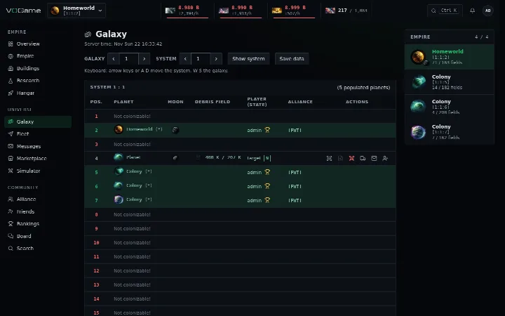
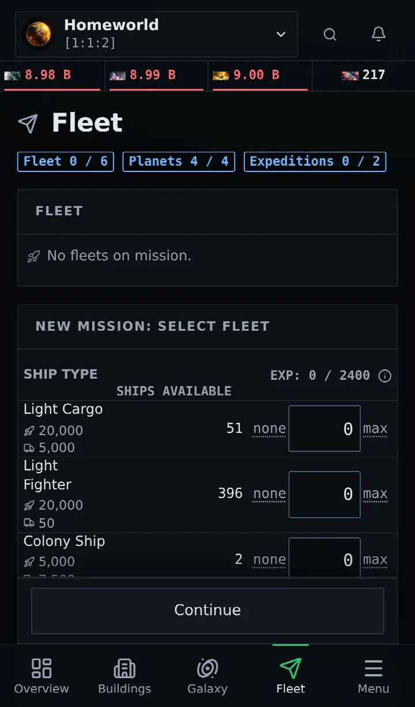
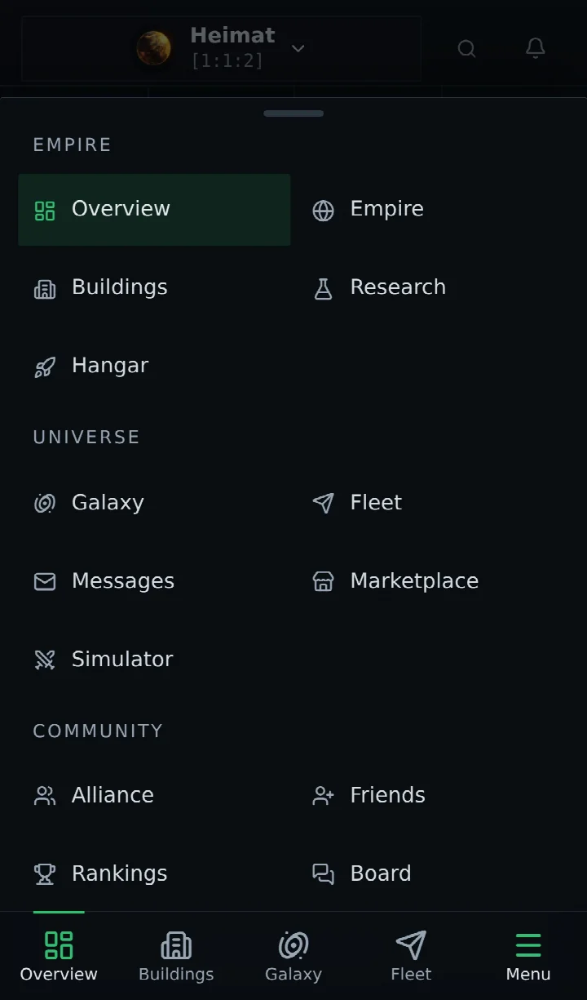

<div align="center">

# V0Game

**An open source browser space strategy game.** Build planets, research technologies, send fleets and fight it out
in alliances.

[](https://github.com/Voidys/V0Game/actions/workflows/ci.yml)
[](https://github.com/Voidys/V0Game/releases/latest)
[](https://github.com/Voidys/V0Game/releases)
[](LICENSE)
[](https://www.php.net/)
[](https://symfony.com/)

[**Install**](#quick-start) · [**Download**](https://github.com/Voidys/V0Game/releases/latest) ·
[Changelog](CHANGES.md) · [Report a bug](https://github.com/Voidys/V0Game/issues)

</div>

V0Game is a space strategy game in the style of the classic browser games. You host it yourself, on ordinary web space
or your own server, and decide the speed, the rules and who may join. It is a fork of
[pr0game](https://codeberg.org/pr0game/pr0game) (which grew out of 2Moons and SteemNova); the game rules are unchanged,
everything around them is new. Developed by **Abraxis**.

## Screenshots

| | | |
| :---: | :---: | :---: |
| <a href="public/styles/resource/images/login/screens/01-overview.webp"></a> | <a href="public/styles/resource/images/login/screens/08-galaxy.webp"></a> | <a href="public/styles/resource/images/login/screens/11-admin-overview.webp"></a> |
| Planet overview | Galaxy | Admin panel |

| | | | |
| :---: | :---: | :---: | :---: |
| <a href="public/styles/resource/images/login/screens/20-mobile-overview.webp"></a> | <a href="public/styles/resource/images/login/screens/21-mobile-buildings.webp"></a> | <a href="public/styles/resource/images/login/screens/23-mobile-fleet.webp"></a> | <a href="public/styles/resource/images/login/screens/24-mobile-drawer.webp"></a> |

More in [`public/styles/resource/images/login/screens/`](public/styles/resource/images/login/screens/).

## Features

- **Modern, phone-friendly interface:** one shared layout with top bar and side menu, bottom tab bar and sheets on
  phones, Ctrl+K quick jump, eight themes, clean URLs (`/game/fleet`).
- **Player tools:** push and Discord notifications, live event list, fleet templates, fleet save finder, raid planner
  and farm list, empire hub, combat reports with profit, a read-only API.
- **Alliances and community:** shared target lists, ACS board, alliance wiki, optional in-game chat, a built-in board,
  news with scheduling, optional toplist voting.
- **Admin panel:** a dashboard that flags problems (e.g. a missing cron job), health checks, a mini CMS for rules and
  legal texts, social login (Discord, Google, GitHub, Facebook).
- **Optional bots** with five personalities to fill a young universe, optionally voiced by an AI service.
- **20 languages**, all complete, plus two fun variants.
- **Privacy and security:** no Google services, self-hosted proof-of-work bot check, CSRF protection, rate limits,
  over 80 old bugs fixed (3 critical, see the [changelog](CHANGES.md)).

## Quick start

You need **PHP 8.4** (`curl`, `ctype`, `gd`, `intl`, `mbstring`, `pdo_mysql`, `xml`, `zip`, ideally `opcache`),
**MySQL 8.4 or MariaDB 10.11**, a **cron job every minute** and about 1 GB of space. Cheap plans that allow cron only
every 15 minutes are not enough.

**Web hosting (ZIP):**
1. Download `v0game-<version>.zip` from the [latest release](https://github.com/Voidys/V0Game/releases/latest)
   (check it against the `.sha256` file) and unpack it on your web space.
   Unpacking on the server is much faster than uploading thousands of files; include the hidden `.env`.
2. Point the domain's document root to the **`public/`** folder, never the project folder: `config/game.php` (database
   password), the source and `var/` must not be reachable from the web. If the host cannot do that, choose another host.
3. Create an empty database, open `https://your-domain/install/` **right away** and follow the wizard (until it is done,
   anyone could set the game up). If it lists something in red, it is usually write access to `var/`, `config/` and
   `.env.local` (folders 775, files 664).
4. Add the cron job shown at the end, running **every minute** ([help](#cron-job)):
   `cd /path/to/v0game && php bin/console app:cron:run --quiet`
5. Turn on HTTPS and log in. The admin home page (`/admin`) lists anything still missing; check mail under
   **Admin → Settings** so password resets work.

**Server with SSH:** download [`install.sh`](install.sh), read it, then run `bash install.sh` (checks PHP, extensions and
Composer, fetches the release, runs the installer; `--help` lists the unattended options, secrets come from
`V0GAME_DB_PASSWORD` / `V0GAME_ADMIN_PASSWORD`). Or run `php bin/console app:install` directly. Then set the document
root to `public/` ([nginx](#nginx); Apache: `AllowOverride All`), let the web server user write to `var/`,
`public/uploads/`, `public/stats/`, `config/` and `.env.local`, add the cron job and HTTPS (`certbot`).

**Try it locally:** `git clone https://github.com/Voidys/V0Game.git && cd V0Game && ddev start && ddev composer install`,
then open https://v0game.ddev.site/install/. DDEV runs the cron by itself.

### Something does not work?

| Symptom | Cause |
| --- | --- |
| 403 on `/install/` or every page | The domain points to the project folder instead of `public/` |
| White page / error 500 | A missing PHP extension (`php -m`) or PHP < 8.4 for the web; see `var/log/game.log` |
| Every URL except the start page 404s | Rewriting is off: Apache `AllowOverride All` + `mod_rewrite`, nginx `try_files` |
| Fleets never arrive, statistics stale | The cron job does not run: run it by hand and read the output; **Admin → Information** |
| Odd pages after an update | `php bin/console cache:clear` and empty `var/game/` |

Still stuck? [Open an issue](https://github.com/Voidys/V0Game/issues) with the end of `var/log/game.log` (no passwords).

## Running a server

**Admin → Information** shows health checks for PHP, extensions, OPcache, folders, migrations, cron, the battle engine,
HTTPS and mail. The Rust battle engine needs Linux x86_64 with glibc ≥ 2.30 and `proc_open`; elsewhere the PHP engine
takes over with the same results.

### Cron job

Add a job **every minute** (`* * * * *`) in the hosting panel ("Cron jobs", "Scheduled tasks") or with `crontab -e` as
the web server user, using the PHP 8.4 binary:

```
cd /var/www/v0game && php bin/console app:cron:run --quiet
# panels that only take a program: /usr/bin/php8.4 /var/www/v0game/bin/console app:cron:run --quiet
```

The admin home page warns while the cron has never run or is more than 5 minutes late. The cron also moves due fleets;
for on-time arrivals (PvP) a server you control should also run the fleet driver as a systemd/supervisor service
(safe next to the cron, event claims are atomic; DDEV does this by itself):

```
cd /var/www/v0game && while true; do php bin/console app:fleets:run --quiet; sleep 5; done
```

### Updating

Back up first. **ZIP:** replace everything **except `config/`, `.env.local`, `var/`, `public/uploads/` and
`public/stats/`** (delete the old `src`, `templates`, `translations`, `vendor`, `public`, `install`, `bin` first), then
open the site once: migrations run on that request. **Script/git:** `bash install.sh --dir .`, or `git pull` +
`composer install --no-dev --optimize-autoloader --classmap-authoritative`. If something looks odd afterwards:
`php bin/console cache:clear` and empty `var/game/`. Notes per version: [CHANGES.md](CHANGES.md).

### Backups

`mysqldump --single-transaction -u USER -p DBNAME > v0game-$(date +%F).sql` (or the admin panel's dumps in
`var/backups/`), plus `config/game.php`, `.env.local` and `public/uploads/`. Keep them outside the web space.

### nginx

Only `public/` is served; everything that is not a file goes to `public/index.php`. Apache needs nothing extra
(`public/.htaccess` handles rewriting, compression and caching; ideally set `DeflateAlterETag NoChange` in the vhost).

```nginx
# http context
map $http_accept $webp_suffix { default ""; "~*image/webp" ".webp"; }
map $arg_v $asset_cache_control { default "public, max-age=31536000, immutable"; "" "no-cache"; }
gzip on; gzip_static on; gzip_vary on;
gzip_types text/css application/javascript text/javascript application/json image/svg+xml;
# optional ngx_brotli: brotli on; brotli_static on; brotli_types (same as gzip_types);

server {
    server_name v0game.example;
    root /var/www/v0game/public;

    location ~ ^/uni[0-9]+/(styles|scripts)/ { rewrite ^/uni[0-9]+/(.*)$ /$1 last; }
    location ~* \.(css|js|mjs)$ { add_header Cache-Control $asset_cache_control; try_files $uri =404; }
    location ~* \.(png|jpe?g|gif)$ { add_header Vary Accept; try_files $uri$webp_suffix $uri =404; }
    location ~ \.cfg$ { deny all; }
    location / { try_files $uri /index.php$is_args$args; }

    location ~ ^/index\.php(/|$) {
        fastcgi_pass unix:/run/php/php8.4-fpm.sock;
        fastcgi_split_path_info ^(.+\.php)(/.*)$;
        include fastcgi_params;
        fastcgi_param SCRIPT_FILENAME $realpath_root$fastcgi_script_name;
        fastcgi_param DOCUMENT_ROOT $realpath_root;
    }
    location ~ \.php$ { rewrite ^ /index.php last; }
}
```

Run `tools/build/precompress.sh` after each deploy to write `.br`/`.gz` copies of CSS, JS and SVG. Anonymous public
pages are sent cacheable for 5 minutes; a reverse proxy cache must honour `Vary: Accept-Language, Cookie`.

### Production tuning

About 20 % less time per request:

```ini
opcache.validate_timestamps=0        ; reload PHP-FPM on every deploy
opcache.memory_consumption=256
opcache.max_accelerated_files=20000
opcache.preload=/path/to/v0game/config/preload.php
opcache.preload_user=www-data
```

Install with `composer install --no-dev --optimize-autoloader --classmap-authoritative`. Deploy: `git pull`,
`composer install …`, `bin/console cache:clear`, empty `var/game/`, `bin/console cache:warmup`, reload PHP-FPM. For the
cron, `php -d opcache.enable_cli=1 -d opcache.file_cache=/var/cache/v0game-opcache bin/console app:cron:run` keeps
compiled scripts between runs.

### Security checklist

- [ ] HTTPS on; `https://your-domain/config/game.php` and `/.env` give 404
- [ ] `config/game.php` and `.env.local` not world-readable (640/660); `var/ENABLE_INSTALL_TOOL` gone after installing
- [ ] `APP_ENV=prod` (the default; never `dev` on a public server, it exposes the profiler)
- [ ] `DEFAULT_URI=https://your-domain` in `.env.local`: mail links are built from it, never from the Host header
- [ ] `TRUSTED_HOSTS=example.com,www.example.com` in `.env.local` (other hosts get 400)
- [ ] Behind a proxy/CDN: `SYMFONY_TRUSTED_PROXIES=<proxy IPs/CIDRs>` (or `REMOTE_ADDR`), else all players share one IP
- [ ] Strong admin password, working mail, system updates, regular backups
- [ ] Anti-abuse settings reviewed per universe; the admin home page lists every protection that is switched off

The anti-abuse defaults are safe: push check for transports (`transport_push_check`, limit `100000`), market skew
`market_push_tolerance` 10 %, `honor_pair_cap` 3 fights per pair and day, `bash_war_exempt` off,
`depot_cost_real_consumption` on. **Admin → Abuse report** lists one-sided transfers, repeated trades and late recalls.

Built in: CSRF tokens on every state change, `HttpOnly`/`SameSite=Lax`/`Secure` session cookies renewed on login,
login and registration throttling, per-account request budgets (`app.game_rate_limit.*` in `config/services.yaml`),
optional daily fleet/attack caps (`app.fleet_launches_per_day`, `app.attacks_per_day`) and security headers.

### Social login

Discord, Google, GitHub and Facebook, all off by default. Set `DEFAULT_URI` in `.env.local`, create an OAuth app with the
callback `https://your-domain/login/<provider>/callback`, paste ID and secret into **Admin → Social login** and switch the
provider on.

| Provider | Create the app at | Scopes |
| --- | --- | --- |
| Discord | [discord.com/developers/applications](https://discord.com/developers/applications) | `identify email` |
| Google | [console.cloud.google.com/apis/credentials](https://console.cloud.google.com/apis/credentials) (Web application) | `openid email profile` |
| GitHub | [github.com/settings/developers](https://github.com/settings/developers) (OAuth App) | `read:user user:email` |
| Facebook | [developers.facebook.com/apps](https://developers.facebook.com/apps/) (Facebook Login) | `email public_profile` |

An existing account with the same e-mail is only linked after its password was entered once; Facebook e-mails never
count as verified.

## Performance vs. pr0game

V0Game 1.26.10 against pr0game ([2b65627](https://codeberg.org/pr0game/pr0game/commit/2b65627953f692104554c3a21e8a0f61f645c170)),
same machine, PHP 8.4 / MySQL 8.4, production mode, the same generated late-game universe (1000 players, 5000 planets,
800 fleets in flight, 100k messages). Median of 15 alternating requests, application time.

| Page | pr0game | V0Game | Change | Queries |
| --- | ---: | ---: | ---: | ---: |
| Galaxy | 153.0 ms | 35.1 ms | **-77 %** | 69 → 27 |
| Statistics | 191.9 ms | 36.3 ms | **-81 %** | 90 → 27 |
| Spy reports | 128.5 ms | 70.7 ms | **-45 %** | 48 → 40 |
| Messages | 54.8 ms | 42.8 ms | -22 % | 47 → 29 |
| Empire | 50.8 ms | 43.3 ms | -15 % | 119 → 66 |
| Overview | 45.3 ms | 40.8 ms | -10 % | 46 → 28 |
| Start page | 12.5 ms | 17.6 ms | +40 % | 5 → 4 |
| **All game pages** (geo. mean) | | | **-28 %** | 693 → 392 |

| Background job | pr0game | V0Game | Change |
| --- | ---: | ---: | ---: |
| Statistics rebuild | 3372 ms | 762 ms | -77 % |
| Daily cronjob | 1364 ms | 907 ms | -34 % |
| Fleet events (≈270, with battles) | 6489 ms | 4800 ms | -26 % |
| Resource update, 5000 planets | 18638 ms | 14308 ms | -23 % |

First visits download 41–71 % less (both gzip-compressed; no jQuery, WebP images). The start page is about 5 ms slower
(Symfony boot). Same seeded data in both, the second round of two; differences around 10 % on small pages are noise.

## Development

PHP 8.4 + Symfony 8.1, Twig templates, plain CSS and native ES modules, game core in `src/Game/`. Battles run in a
bundled Rust engine (40–110× faster, identical results) with an automatic PHP fallback. Local setup with
[DDEV](https://ddev.readthedocs.io/):

```sh
ddev exec vendor/bin/phpunit                   # unit + integration tests (db_test)
ddev composer phpstan                          # static analysis, level 6
ddev exec vendor/bin/php-cs-fixer fix          # PER Coding Style
ddev exec bin/console lint:twig templates
```

CI ([`ci.yml`](.github/workflows/ci.yml)) also checks docblocks, method length, the Rust engine build and battle
parity, and shellcheck. Releases: bump `install/VERSION` (`1.<yy>.<n>`) and push a `v*` tag.
Issues and pull requests are welcome.

## Thanks

Thanks to everyone who worked on the earlier versions of this game: the pr0game dev team, the 2Moons and SteemNova
developers and everyone before them. This update (Symfony and Twig port, new interface, bug fixes, performance work)
was made with the help of Claude. Codeberg does not allow AI-assisted coding, so the project lives on GitHub.
— *Abraxis* · **[www.voidverse.net](https://www.voidverse.net)**

## License and credits

[AGPL v3](LICENSE). V0Game is a fork of pr0game, a fork of SteemNova, a fork of [2Moons](https://github.com/jkroepke/2Moons).

- Code © 2009-2016 Jan-Otto Kröpke, MIT License.
- Code © 2018 @steemnova, MIT License.
- Code © 2018-2020 @IntinteDAO, MIT License (f66f0bf9f2d502f9cc3932e7f05e4795b3622ce6); from 07.05.2020 AGPLv3.
- Code © 2022-2026 the pr0game dev team and community ([codeberg.org/pr0game/pr0game](https://codeberg.org/pr0game/pr0game)), AGPLv3.
- Code © 2026 Abraxis and the V0Game contributors, AGPLv3.

Credits: 2026 V0Game – Abraxis · 2022-2026 pr0game – pr0game dev team and community · 2018-2020 SteemNova – @steemnova,
@IntinteDAO · 2009-2019 2Moons – jkroepke · 2008-2014 XGProyecto – lucky · 2008-2009 XNova 0.9a – XNova Group ·
2006-2007 UGamela 0.4 – Phoscur · 2004-2006 UGamela 0.2h – Perberos
