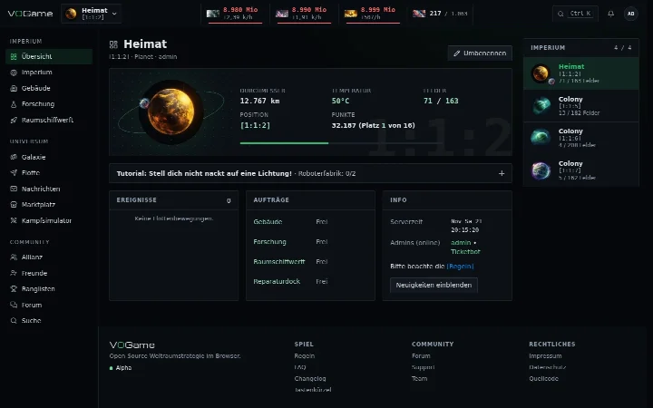
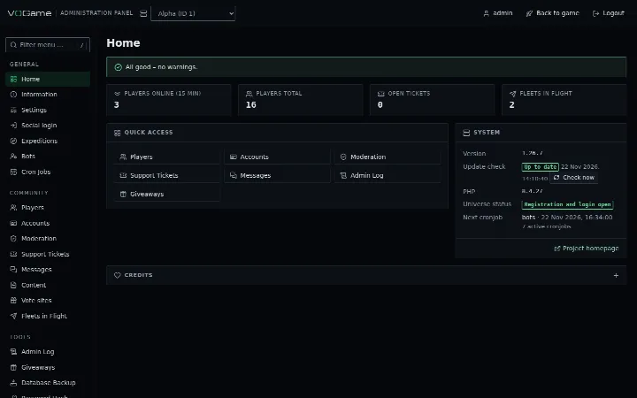
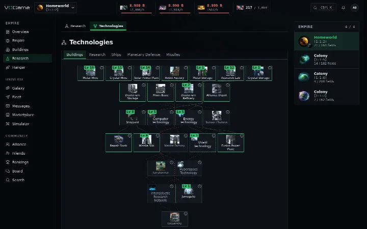
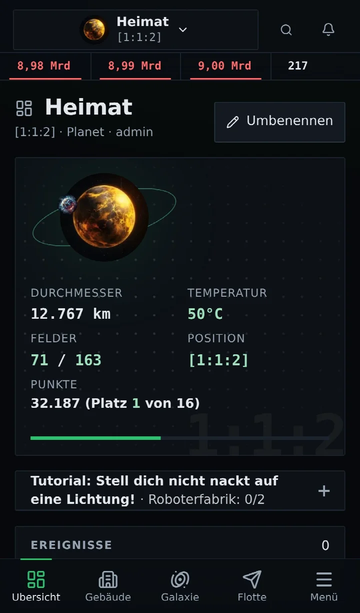
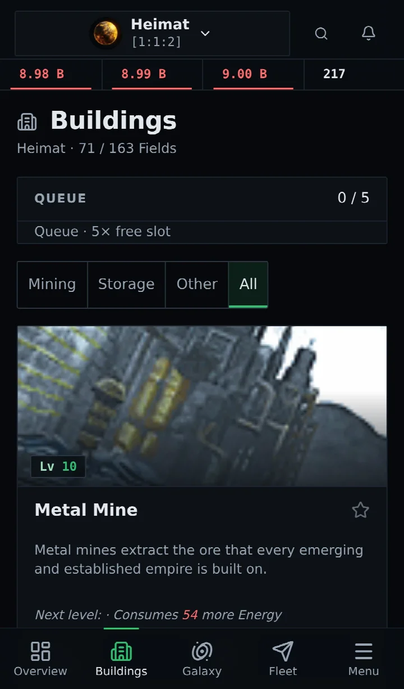
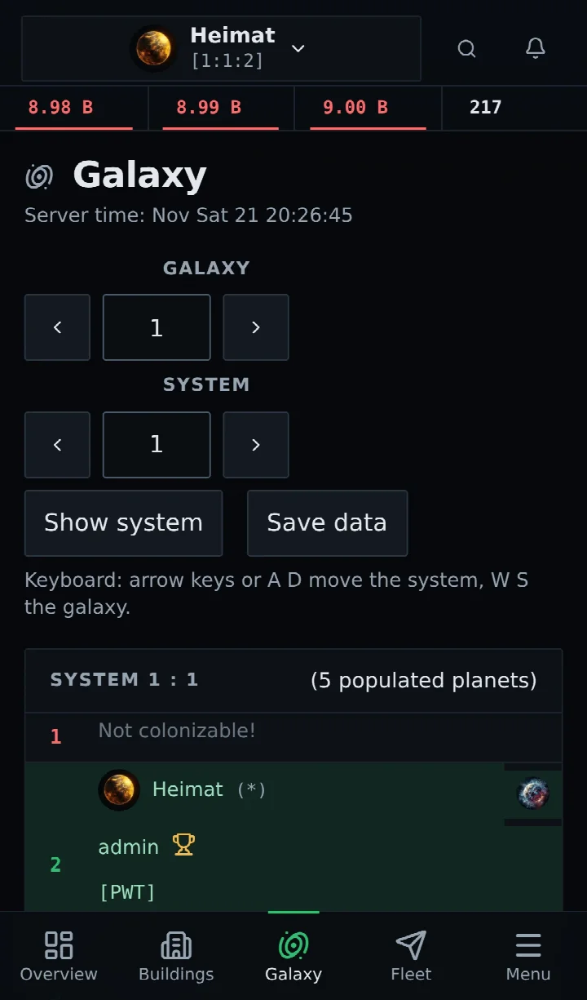

<div align="center">

# V0Game

**An open source browser space strategy game.** Build planets, research technologies, send fleets and fight it out
in alliances.

[](https://github.com/Voidys/V0Game/actions/workflows/ci.yml)
[](https://github.com/Voidys/V0Game/actions/workflows/release.yml)
[](https://github.com/Voidys/V0Game/releases/latest)
[](https://github.com/Voidys/V0Game/releases)
[](LICENSE)
<br>
[](https://www.php.net/)
[](https://symfony.com/)
[](https://twig.symfony.com/)
[](docs/INSTALL.md)
[](https://github.com/Voidys/V0Game/commits/main)

[**Install guide**](docs/INSTALL.md) · [**Download**](https://github.com/Voidys/V0Game/releases/latest) ·
[Changelog](CHANGES.md) · [Report a bug](https://github.com/Voidys/V0Game/issues)

</div>

> **V0Game lives on at GitHub.** It is a fork of [pr0game](https://codeberg.org/pr0game/pr0game), which grew out of
> 2Moons and SteemNova. Codeberg does not allow AI-assisted coding, so the project moved here. Issues, pull requests
> and releases go to this repository.

## What is this?

V0Game is a space strategy game in the style of the classic browser games: players build up planets, research
technologies, send fleets, trade and fight together in alliances. Everything happens in the browser, on a phone too.

You run it yourself: put it on your own web space or server, and you have your own game for friends or a community.
You decide the speed, the rules and who may join. It is free and open source.

V0Game is developed by **Abraxis**.

## Contents

**Everyone**
- [Highlights](#highlights)
- [Screenshots](#screenshots)
- [Features](#features)
- [Can my hosting run it?](#can-my-hosting-run-it)
- [Quick start](#quick-start)
- [After installing](#after-installing)
- [Something does not work?](#something-does-not-work)

**Server admins and developers** (technical)
- [Requirements](#requirements)
- [Running a server](#running-a-server)
- [Performance](#performance)
- [Development](#development)
- [Battle engines](#battle-engines)
- [Tech stack](#tech-stack)

**About**
- [Thanks](#thanks)
- [Origin, license and credits](#origin-license-and-credits)

## Highlights

The game rules are the same as before; everything around them is new.

| | |
| --- | --- |
| **Over 80 old game bugs fixed** | Including **3 critical** ones: a jump gate security hole, a way to duplicate ships at the repair dock, and a cleanup job that could delete every player ([the list](docs/GAMEBUGS.md)). Four more review rounds fixed many smaller glitches since ([changelog](CHANGES.md)) |
| **Pages up to 65 % faster** | A typical game page loads about 30 % faster and asks the database half as often. With the recommended server settings, pages take about half their old time ([numbers](#performance)) |
| **Background jobs up to 96 % faster** | Statistics, records and resource updates need a fraction of the time, so even large servers stay quick |
| **Lighter downloads** | Images as WebP (53.7 MB → 12.7 MB), scripts 3.1 MB → 512 KB, the biggest pages about half their size |
| **Easy to set up** | A setup wizard in the browser, a ready-to-upload ZIP, and help in the admin panel when something is missing |

## Screenshots

| | |
| :---: | :---: |
| <a href="public/styles/resource/images/login/screens/01-overview.webp"></a> | <a href="public/styles/resource/images/login/screens/02-buildings.webp"></a> |
| Planet overview | Buildings |
| <a href="public/styles/resource/images/login/screens/07-empire.webp"></a> | <a href="public/styles/resource/images/login/screens/11-admin-overview.webp"></a> |
| Empire with statistics charts | Admin panel |
| <a href="public/styles/resource/images/login/screens/08-galaxy.webp"></a> | <a href="public/styles/resource/images/login/screens/06-techtree.webp"></a> |
| Galaxy | Technology tree |

### On phones

| | | | | |
| :---: | :---: | :---: | :---: | :---: |
| <a href="public/styles/resource/images/login/screens/20-mobile-overview.webp"></a> | <a href="public/styles/resource/images/login/screens/21-mobile-buildings.webp"></a> | <a href="public/styles/resource/images/login/screens/22-mobile-galaxy.webp"></a> | <a href="public/styles/resource/images/login/screens/23-mobile-fleet.webp"></a> | <a href="public/styles/resource/images/login/screens/24-mobile-drawer.webp"></a> |
| Overview | Buildings | Galaxy | Fleet | Menu sheet |

All of them, desktop and phone, are in [`public/styles/resource/images/login/screens/`](public/styles/resource/images/login/screens/); a running game shows them on its start page under Screenshots.

## Features

- **Modern interface:**
  - top bar with resources, side menu and a planet list, one strict layout for every page;
  - built for phones too: bottom tab bar in thumb reach, menus as bottom sheets, 44 px touch targets;
  - quick jump with Ctrl+K (pages, planets, coordinates), keyboard shortcuts, tooltips everywhere;
  - eight themes (new: VoidVerse) that only set colours, fonts and images (a new theme is a short file, see `docs/themes.md`),
    popups as modals, clean web addresses (`/game/fleet` instead of `game.php?page=fleet`).
- **Player tools:**
  - push and Discord notifications for attacks, spies, returning fleets, finished queues and farms that wake up;
  - a live event list, fleet templates, a fleet save finder and an "arrive at" speed picker;
  - a raid planner in every spy report and a farm list, galaxy filters and marks, an empire hub that collects resources;
  - "build up to X" in the shipyard, combat reports with losses and profit, a read-only API for your own tools;
  - every universe setting on one page (`/rules/universe`).
- **Alliances and chat:** shared target lists, an ACS board, an activity overview, alliance wiki pages, pacts that expire,
  and an optional in-game chat (global and alliance channels, filters, reports, admin review), switched on in the admin panel.
- **Community:**
  - a built-in board with posts, votes and threaded comments;
  - news with drafts, scheduling and images;
  - a team page managed in the admin panel;
  - optional voting for your game on toplists, with rewards (off by default).
- **Admin panel:**
  - a dashboard that warns you when something needs attention (for example a missing cron job);
  - a mini CMS for rules, imprint and privacy texts, and a GDPR privacy policy filled from the game settings;
  - a server information page with health checks, database facts and game statistics.
- **Bots** (optional, off by default):
  - bot players fill a young universe; five ready-made personalities: office worker, jobless, shift worker, lunatic and noob;
  - they play on their own, no extra service needed; no two build the same;
  - optionally an AI service (OpenAI, Claude, OpenCode Go, DeepSeek, OpenRouter) gives them names, chat and alliance life;
  - start them in the setup wizard or later under **Admin → Bots**.
- **Languages:** 20 languages, all complete: German, English, Spanish, French, Italian, Dutch, Polish, Czech, Hungarian,
  Romanian, Portuguese, Brazilian Portuguese, Russian, Ukrainian, Turkish, Thai, Filipino, Vietnamese, Simplified Chinese and
  Traditional Chinese, plus two fun variants (Ogerfränkisch and pirate German).
- **Privacy and security:**
  - no Google services: no Analytics, and a self-hosted bot check instead of reCAPTCHA;
  - a modern, secure login, and every page is protected against code injected by other players;
  - optional social login: players sign in or register with Discord, Google, GitHub or Facebook (each off by default,
    switched on under **Admin → Social login**); an existing account is only linked after its password was entered once;
  - the installer creates all secrets for you.

The full list, step by step, is in the **[changelog](CHANGES.md)**.

## Can my hosting run it?

Most web hosts that offer current PHP can. Check these four points in your hosting panel or ask your host:

| You need | Why | Where to look |
| --- | --- | --- |
| **PHP 8.4** | The game is written in PHP | "PHP version" or "PHP settings" |
| **A MySQL or MariaDB database** (MySQL 8.4 / MariaDB 10.11) | Stores players, planets and fleets | "Databases" |
| **Cron jobs every minute** | Fleets, building queues and statistics are processed in the background | "Cron jobs", "Scheduled tasks" |
| **About 1 GB of space** | Mostly theme images | Your hosting plan |

Also good to have: HTTPS (a free "Let's Encrypt" certificate, offered by almost every host) and the option to choose
the folder your domain points to ("document root").

> **Watch out:** some cheap plans allow cron jobs only every 15 minutes or not at all. The game needs one every minute,
> otherwise fleets arrive late and the game feels stuck. Check this before you buy.

## Quick start

Pick the way that fits you. The **[install guide](docs/INSTALL.md)** walks through each one in detail, written for
non-technical readers too.

| Way | For whom | You need |
| --- | --- | --- |
| [**ZIP download**](#1-zip-download) | Ordinary web hosting, no command line | Your hosting panel and an FTP program or file manager |
| [**Install script**](#2-install-script) | A VPS or server you log into with SSH | Git, PHP 8.4, Composer (the script checks and helps) |
| [**DDEV**](#3-ddev-try-it-on-your-pc) | Trying it on your own PC | Docker and DDEV |

### 1. ZIP download

1. **Download** `v0game-<version>.zip` from the [latest release](https://github.com/Voidys/V0Game/releases/latest).
   Download only from that page. *Optional but recommended:* also download the `.sha256` file and
   [check that the ZIP is undamaged](docs/INSTALL.md#1-download-and-check-the-file).
2. **Upload** the ZIP to your web space and unpack it there (most file managers in hosting panels can do this; it is
   much faster than uploading the unpacked files). The ZIP is about 80 MB, mostly theme artwork.
3. **Point your domain to the `public/` folder.** In the hosting panel look for "Domains" and "Document root" (also
   called "Web root") and set it to the `public` folder inside the unpacked folder, for example `v0game/public`.
   This keeps passwords and program files out of reach of visitors. [Why and how](docs/INSTALL.md#4-point-the-domain-to-the-public-folder).
4. **Create an empty database** in the hosting panel and write down its host (often `localhost`), name, user and password.
5. **Open `https://your-domain/install/`** and follow the wizard. It checks your hosting, asks for the database
   details, the game name, speed and your admin account. Do this right after uploading: until it is finished,
   anyone who opens the page could set the game up.
6. **Set up the cron job.** The last wizard page shows a line like
   `cd /path/to/v0game && php bin/console app:cron:run --quiet`. Create a cron job in your hosting panel that runs it
   **every minute**. Without it fleets never arrive and nothing progresses.
   [Step-by-step help for hosting panels](docs/INSTALL.md#7-set-up-the-cron-job).
7. **Turn on HTTPS** in the hosting panel, if it is not on yet.

### 2. Install script

Download it, read it, then run it. Please don't pipe it into a shell.

```sh
curl -fsSLO https://raw.githubusercontent.com/Voidys/V0Game/main/install.sh
less install.sh
bash install.sh                 # interactive menu
bash install.sh --help          # all options, e.g. --mode server --dir /var/www/v0game --dry-run
```

The script:
- checks PHP, its extensions and Composer, with install hints for apt, dnf and pacman;
- fetches the latest release and installs the dependencies;
- runs the command line installer or points you to the web wizard;
- prints the remaining steps at the end.

It never runs `sudo` by itself. You can also run the installer directly:

```sh
php bin/console app:install     # asks for everything, or pass --no-interaction with options (see --help)
```

Then:
- set your web server's **document root to the `public/` folder** of the install directory, not the project folder
  itself ([nginx example](docs/nginx.md); Apache: `DocumentRoot …/public` with `AllowOverride All`);
- add the **cron job** that runs every minute:
  `* * * * * cd /path/to/v0game && php bin/console app:cron:run --quiet` (`crontab -e` as the web server's user;
  [details](docs/INSTALL.md#7-set-up-the-cron-job));
- turn on HTTPS, for example with certbot.

### 3. DDEV (try it on your PC)

```sh
git clone https://github.com/Voidys/V0Game.git
cd V0Game
ddev start
ddev composer install
```

Then open **https://v0game.ddev.site/install/**. DDEV runs the cron job by itself.

## After installing

1. **Log in** at `https://your-domain/` with the admin account from the wizard. The admin panel is at
   `https://your-domain/admin`.
2. **Look at the admin home page.** It says "All good" or lists what still needs attention, for example a cron job
   that is not running yet, or the web address that e-mails need for their links.
3. **Check the settings** under **Admin → Settings**: game name, universe speed, registration, and e-mail (needed for
   password resets and account activation).
4. **Optional:** add bots under **Admin → Bots** so the universe does not feel empty, write the rules and imprint
   under **Admin → Content**, post a first news entry, and let players sign in with Discord, Google, GitHub or Facebook
   under **Admin → Social login** ([setup](#social-login)).
5. **Invite your players.** They register on the start page.

Keep backups of the database and of `config/game.php` ([how](docs/INSTALL.md#backups)).

## Something does not work?

| What you see | Most likely cause |
| --- | --- |
| **"403 Forbidden"** on `/install/` or every page | The domain points to the project folder instead of `public/` ([step 3](#1-zip-download)) |
| **Fleets never arrive**, buildings don't finish, statistics don't update | The cron job is not running. The admin home page warns about this ([help](docs/INSTALL.md#7-set-up-the-cron-job)) |
| **White page or "Error 500"** right after uploading | Often a missing PHP extension or an older PHP version. The error log is in `var/log/` |
| **Pages show without design**, or every page except the start page gives 404 | The web server ignores the `.htaccess` file (Apache: `AllowOverride All`; nginx: see [nginx.md](docs/nginx.md)) |
| **"Not writable"** in the wizard | The web server needs write access to `var/`, `config/` and `public/uploads/` (folders 775, files 664 in the file manager) |
| **The wizard says it is closed** | The game is already installed, or `var/` is not writable |

More answers: [troubleshooting in the install guide](docs/INSTALL.md#troubleshooting). Still stuck?
[Open an issue](https://github.com/Voidys/V0Game/issues).

## Requirements

*From here on it gets technical. If you just want to run a game, the sections above are all you need.*

The technical list for server admins:

| | |
| --- | --- |
| PHP | 8.4 with `curl`, `gd`, `intl`, `mbstring`, `mysql` (pdo_mysql), `xml`, `zip`, `opcache` (recommended), `openssl` (for SMTP with TLS) |
| Database | MySQL 8.4 or MariaDB 10.11 |
| Web server | nginx or Apache with the document root on `public/` ([nginx example with WebP delivery](docs/nginx.md)) |
| Cron | One job every minute (see [Quick start](#quick-start)) |
| Composer | Only for the script and git installs; the release ZIP already contains `vendor/` |
| Battles | The fast Rust engine needs Linux x86_64 with glibc ≥ 2.30 and PHP's `proc_open`. Everywhere else the PHP engine is used automatically, with the same results |

## Running a server

- **Cron:** the game's background jobs (fleets, statistics, cleanup, bots…) run every minute:

  ```
  * * * * * cd /path/to/v0game && php bin/console app:cron:run --quiet
  ```

  On a server you control, an extra fleet loop makes arrivals exact to the second ([details](docs/INSTALL.md#7-set-up-the-cron-job)).
- **Health check:** **Admin → Information** shows ok/warning/error checks for:
  - PHP, its extensions and OPcache;
  - writable folders, pending migrations and cron;
  - the battle engine, HTTPS and mail.
- **Updates:** back up first ([how](docs/INSTALL.md#backups)).
  - ZIP installs: replace all files **except** `config/`, `.env.local`, `var/`, `public/uploads/` and `public/stats/`
    ([step by step](docs/INSTALL.md#updating)).
  - Git or script installs: `git pull && composer install --no-dev -o`, or `bash install.sh --dir .`.
  - Database changes are applied automatically on the next page load.
- **Performance:** OPcache settings (`validate_timestamps=0`), preloading and an authoritative class map are described in
  [docs/PERFORMANCE.md](docs/PERFORMANCE.md).
- **Compression and caching:** serve brotli and precompressed `.br`/`.gz` files for CSS, JS and SVG
  (`tools/build/precompress.sh`, nginx `brotli_static`/`gzip_static`), keep `?v=` assets `immutable`, and on Apache set
  `DeflateAlterETag NoChange` (or keep the ETag removal of `public/.htaccess`), otherwise revalidation answers `200` instead of `304`
  ([docs/nginx.md](docs/nginx.md#compression)).
- <a id="social-login"></a>**Social login** (Discord, Google, GitHub, Facebook; all off by default):
  1. set `DEFAULT_URI=https://your-domain` in `.env.local` (the callback addresses are built from it);
  2. create an OAuth app at the provider and enter its callback address `https://your-domain/login/<provider>/callback`
     (shown in **Admin → Social login**);
  3. paste client ID and secret into **Admin → Social login** and switch the provider on.

  A login whose e-mail matches an existing account is never linked automatically: the owner confirms with the account
  password once. Players can connect or disconnect providers in their account settings. Scopes, provider links and the
  exact flow: [docs/social-login.md](docs/social-login.md).
- **Security:** see the checklist in [docs/INSTALL.md#security-checklist](docs/INSTALL.md#security-checklist):
  - HTTPS on;
  - the document root on `public/`;
  - `config/game.php` kept private;
  - a strong admin password.

## Performance

The numbers behind "faster", compared with the code before the performance work. Game results are unchanged: every change was checked with crawl
diffs of all pages, and the statistics and resource routines were checked by running old and new code side by side.
The method and the raw numbers are in [docs/PERFORMANCE.md](docs/PERFORMANCE.md).

**Pages.** The times are medians in production mode. "Tuned" adds the OPcache and Composer settings from
[docs/INSTALL.md](docs/INSTALL.md). The two measuring rounds ran on different machines, so the time changes combine
the ratios of both rounds.

| Page | Queries before → now | Time, default | Time, tuned |
| --- | ---: | ---: | ---: |
| Start page | 8 → 5 | -26 % | -47 % |
| News | 9 → 6 | -25 % | -55 % |
| Account | 14 → 8 | -23 % | -50 % |
| Overview | 48 → 25 | -29 % | -49 % |
| Buildings | 40 → 20 | -26 % | -46 % |
| Research | 40 → 21 | -31 % | -49 % |
| Shipyard | 39 → 19 | -34 % | -52 % |
| Galaxy | 71 → 25 | -41 % | -60 % |
| Messages | 49 → 30 | -28 % | -48 % |
| Statistics | 47 → 24 | -33 % | -59 % |
| Empire | 116 → 28 | -54 % | -65 % |
| Alliance | 41 → 31 | -30 % | -46 % |
| Admin overview | 22 → 11 | -28 % | -52 % |

**Background jobs** (1000 players, 5000 planets, 100k messages):

| Job | Before | Now | Change |
| --- | ---: | ---: | ---: |
| Statistics cronjob | 1560 ms, 4375 queries | 213 ms, 66 queries | -86 % |
| Statistics build | 601 ms, 1090 queries | 150 ms, 52 queries | -75 % |
| Records build | 976 ms, 3281 queries | 35 ms, 10 queries | -96 % |
| Resource update, 5000 planets | 2581 ms, 10000 queries | 1130 ms, 5000 queries | -56 % |
| Resource update, 1000 planets with save | 951 ms | 644 ms | -32 % |
| Fleet events, 600 due fleets | 2687 ms | 2048 ms | -24 % |

**What else got faster:**
- Galaxy:
  - switching systems no longer reloads the page;
  - with 100k messages a system switch takes about 28 ms instead of 168 ms, thanks to a new index.
- Smaller pages: tooltips are sent once per page instead of once per element. The galaxy page went from 258 to 108 KB,
  buildings from 121 to 63 KB and research from 95 to 54 KB.
- Messages:
  - one query for all counters;
  - only the text of the shown page is loaded;
  - spy reports are rendered once and then cached.
- Every request:
  - the universe config and the migration check are cached;
  - fleet events, ban checks and tutorials cost no queries when there is nothing to do;
  - read-only page views take no row locks.
- Frontend:
  - no jQuery (scripts 3.1 MB → 512 KB);
  - brotli/gzip and long-term caching for versioned assets;
  - preloaded fonts and lazy-loaded building images;
  - WebP images;
  - theme artwork 139 → 83 MB.

## Development

Local development uses [DDEV](https://ddev.readthedocs.io/) (see [Quick start](#3-ddev-try-it-on-your-pc)).

```sh
ddev exec bin/console lint:twig templates                                   # template syntax
ddev exec bin/console lint:container                                        # service container
ddev exec vendor/bin/php-cs-fixer fix                                       # code style: PER Coding Style
```

- **Testing:** PHPUnit (`tests/Unit` needs no database, `tests/Integration` runs against a dedicated database `db_test`):

  ```sh
  ddev exec vendor/bin/phpunit                        # everything (also: ddev composer test)
  ddev exec vendor/bin/phpunit --testsuite Unit       # no database needed (also: ddev composer test:unit)
  ddev exec vendor/bin/phpunit --filter BuildFunctionsTest
  ```

  - The test database name must end in `_test` (`.env.test`, `DATABASE_URL`); the tests refuse to run against anything else, so the dev database `db` is never touched. DDEV's `db` user may need `GRANT ALL ON db_test.*`; DDEV's root user can do that (`ddev mysql -uroot -proot -e "CREATE DATABASE IF NOT EXISTS db_test; GRANT ALL ON db_test.* TO 'db'@'%';"`).
  - Every run rebuilds the schema of `db_test` from `install/install.sql` and the migrations; each test runs in a rolled-back transaction.
  - The mechanics tests compare against golden values captured from the code before the legacy renewal (prices, build times, production, queues, fleet maths, battles). A failing golden test means a result changed; only update the value (`GOLDEN_CAPTURE=1 vendor/bin/phpunit --filter <Class>` prints the new values to `var/golden/`) when the change is intended.
  - The Rust battle engine is checked against the PHP engine with the same seed (`mt_srand` / `BattleEngineRust::useSeed()`): results must be identical field by field, on the golden fleets and on 300 generated battles (`BATTLE_PARITY_RUNS=5000` for a longer soak). `sh tools/battlerust/build.sh test` runs the crate's own tests (RNG against PHP sequences, engine rules).
- **Static analysis:** PHPStan level 6 — new code needs full parameter, return and property types (`phpstan.dist.neon`, known findings in `phpstan-baseline.neon`; the symfony extension reads `var/cache/dev/App_KernelDevDebugContainer.xml`, so warm the dev cache first):

  ```sh
  ddev composer phpstan
  ```

  New findings fail the run; fix them rather than extending the baseline.
- Errors land in `var/log/`. After changing translations or game data, clear `var/game/`.
- Template and escaping rules are in [docs/templates.md](docs/templates.md).
- Page layout rules (spacing scale, page head, panels, tables, forms, phones and touch) are in
  [docs/ui-layout.md](docs/ui-layout.md); themes and how to make a new one in [docs/themes.md](docs/themes.md).
- Typed game data (element catalog, player/planet snapshots) — new code reads through it: [docs/game-data-model.md](docs/game-data-model.md).
- **CI** ([`ci.yml`](.github/workflows/ci.yml)) runs on every push to `main` and on every pull request:
  - composer validate;
  - PHP syntax, Twig, YAML and container lint;
  - a docblock on every complex function and no method over 80 lines (`tools/ci/docblock-check.php`,
    `tools/ci/long-methods-check.php`);
  - the PHPUnit suite against a MySQL 8.4 service container (`db_test`);
  - the Rust battle engine: `cargo test`, a rebuild of `bin/libbattlerust.so` (must equal the committed sha256) and the battle parity tests against the fresh library;
  - `bash -n` and shellcheck for the install scripts.
- **Releases** ([`release.yml`](.github/workflows/release.yml)):
  - bump `install/VERSION` (year scheme `1.<yy>.<patch>`, e.g. `1.26.0`) and push a tag `v1.26.0`;
  - the workflow builds the ZIP with `tools/release/build.sh` and attaches it with its SHA256 to the GitHub release.
- **Bugs and ideas:** [GitHub issues](https://github.com/Voidys/V0Game/issues). Pull requests are welcome.

## Battle engines

The game uses the first engine that is available:

- **Rust (default):**
  - 40–110× faster than the PHP engine for medium and large fights, and it fights exactly like the PHP engine (same rules, same random draws: with the same seed the result is identical);
  - runs through the bundled launcher `bin/battlerust`, which loads `bin/libbattlerust.so`, so there's nothing to install and no PHP extension;
  - Linux x86_64 with glibc 2.30 or newer (Ubuntu 20.04+, Debian 11+, RHEL/Alma/Rocky 9+);
  - the source is in [`tools/battlerust/`](tools/battlerust) (Rust, builds in Docker, nothing else needed): `sh tools/battlerust/build.sh` rebuilds `bin/libbattlerust.so` reproducibly, `build.sh test` runs the crate tests, `build.sh check` compares a fresh build with the committed library; formats and details in [docs/battle-engine-contract.md](docs/battle-engine-contract.md);
  - rebuild the launcher with `sh tools/battlerust-cli/build.sh`.
- **PHP (fallback):**
  - always available, and used on other systems (ARM, Alpine/musl, older distributions);
  - very large fights (over 500 000 units) are computed on proportionally scaled unit counts;
  - also takes over when the Rust engine refuses a fight (over 60 million ships) or fails.

## Tech stack

| Part | Technology |
| --- | --- |
| Backend | PHP 8.4, Symfony 8.1 (routing, Security login, sessions, DI container, console), the game logic in `src/Game/` |
| Templates | Twig with autoescaping (`templates/{login,game,account,admin,install}`) |
| Frontend | Plain CSS in cascade layers and native ES modules (`public/styles/`, `public/scripts/`), no jQuery, no CSS framework |
| Themes | Eight skins in `public/styles/theme/`; each sets a small contract of colours, fonts and images (`theme-contract.css`), the layout is shared ([docs/themes.md](docs/themes.md)) |
| Database | MySQL 8.4 or MariaDB 10.11; schema in `install/install.sql`, changes as migrations in `install/migrations/` |
| Charts | Reduced Chart.js 4 build (`public/scripts/lib/chart.js`, rebuild with `sh tools/chartjs/build.sh`) |
| Translations | `translations/<domain>.<locale>.yaml`, 22 complete locales (20 languages and two fun variants) |

## Thanks

**Thanks to everyone who worked on the earlier versions of this game: all maintainers and contributors so far, the
pr0game dev team, the 2Moons and SteemNova developers and everyone before them. This codebase exists because of years
of their work.**

Why this update: a few friends wanted to play the classic version again, but with a modern touch. This update (the
Symfony and Twig port, new interface, bug fixes, performance work) was made with the help of Claude, because I had
resources left on my weekly usage. — *Abraxis*

Check out my modern interpretation of a sci-fi browser game: **[www.voidverse.net](https://www.voidverse.net)**

## Origin, license and credits

Based on [2Moons](https://github.com/jkroepke/2Moons), [SteemNova](https://github.com/steemnova/steemnova) and
[pr0game](https://codeberg.org/pr0game/pr0game). Licensed under the [AGPL v3](LICENSE).

**Copyright**
- SteemNova is a fork of the open source browser game framework jkroepke/2Moons. pr0game is a fork of SteemNova, and
  V0Game is a fork of pr0game.
- Code copyright 2009-2016 Jan-Otto Kröpke, released under the MIT License.
- Code copyright 2018 @steemnova, released under the MIT License.
- Code copyright 2018-2020 @IntinteDAO, released under the MIT License (f66f0bf9f2d502f9cc3932e7f05e4795b3622ce6).
- Code copyright 07.05.2020-2020 @IntinteDAO, released under the AGPLv3 License.
- Code copyright 2022-2026 the pr0game dev team and community ([codeberg.org/pr0game/pr0game](https://codeberg.org/pr0game/pr0game)), released under the AGPLv3 License.
- Code copyright 2026 Abraxis and the V0Game contributors, released under the AGPLv3 License.

**Credits**
- 2026 V0Game - Abraxis
- 2022-2026 pr0game - pr0game dev team and community
- 2018-2020 SteemNova - @steemnova, @IntinteDAO
- 2009-2019 2Moons Browsergame Engine - jkroepke
- 2008-2014 XGProjecto - lucky
- 2008, 2009 XNova "XNova 0.9a" - XNova Group / xnova.fr
- 2006-2007 UGamela 0.4 - Phoscur
- 2004-2006 UGamela 0.2h - Perberos
